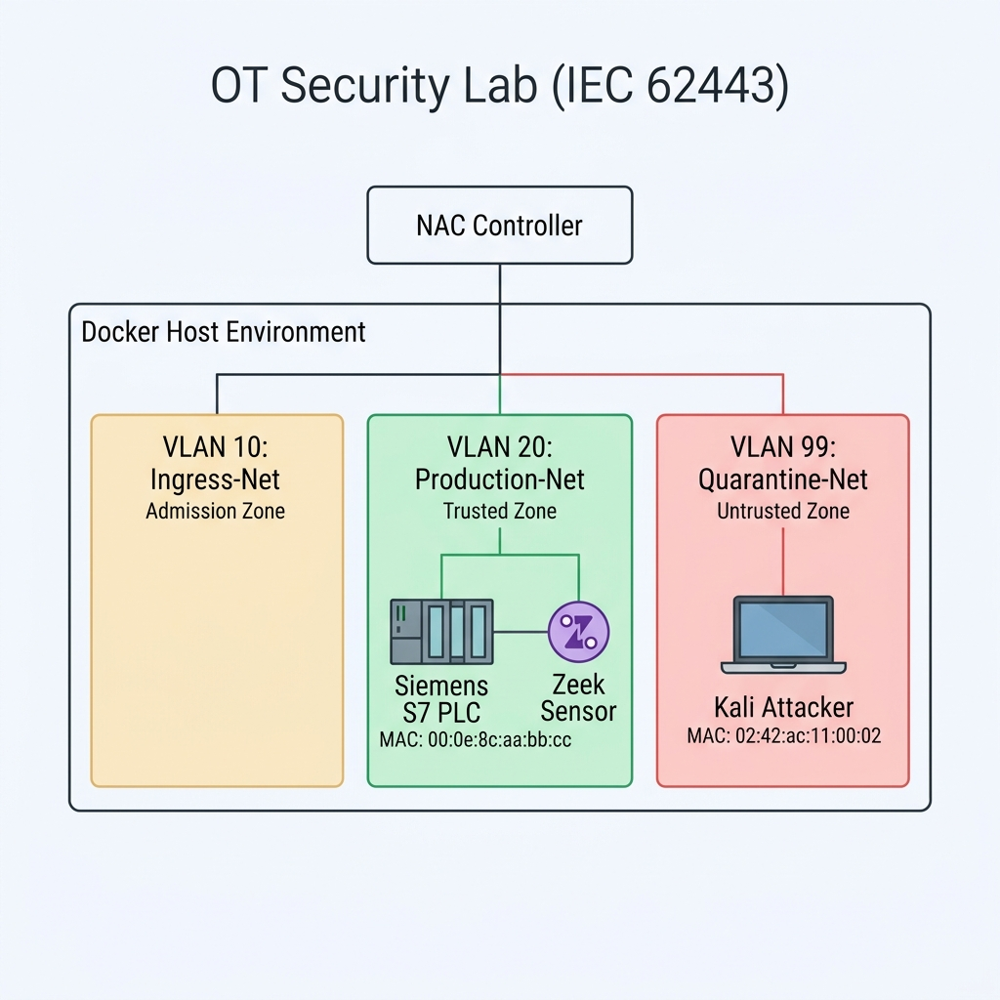

## Module 2: Asset Visibility with Malcolm/Zeek & Network Access Control

---

### 1. วัตถุประสงค์การปฏิบัติงาน (Lab Objectives)
1. **เข้าใจหลักการ Asset Visibility & Discovery ในระบบ OT:** เรียนรู้การตรวจจับและวิเคราะห์โปรโตคอลอุตสาหกรรมเชิงรับ (Passive Monitoring) ด้วยเครื่องมือมาตรฐานอย่าง Zeek เพื่อระบุประเภทอุปกรณ์ โดยไม่กระทบกระเทือนสายการผลิต (Zero Downtime)
2. **เรียนรู้การจำแนกอุปกรณ์ (Device Profiling) และการทำ CMDB:** ตรวจสอบและลงทะเบียนอุปกรณ์ผ่านค่า MAC Address OUI (Organizationally Unique Identifier) แบบ Agentless
3. **เข้าใจและติดตั้งระบบ Dynamic Segmentation ผ่าน NAC:** เรียนรู้กลไกการจัดกลุ่มและโยกย้ายอุปกรณ์เข้าสู่ Virtual VLANs ที่ถูกต้องตามสถาปัตยกรรม Purdue Model
4. **ทดสอบการตอบสนองและตระหนักถึงข้อจำกัดของระบบ (Zero Trust & Bypass Attack):** ฝึกกักกัน (Quarantine) อุปกรณ์แปลกปลอม และทดสอบการโจมตีผ่าน MAC Spoofing เพื่อเข้าใจจุดอ่อนของระบบ NAC แบบดั้งเดิม

---

### 2. สถานการณ์จำลอง และ แผนผังเครือข่ายจำลอง (Simulated Scenario & Network Topology)

#### 📌 สถานการณ์จำลอง (Simulated Scenario)
ณ โรงงานบรรจุเครื่องดื่มอัตโนมัติ (Beverage Bottling Plant) ทีมวิศวกร OT ได้รับมอบหมายให้ปรับปรุงความมั่นคงปลอดภัยตามมาตรฐาน **IEC 62443** เนื่องจากโรงงานกำลังประสบปัญหาขาดการมองเห็นสินทรัพย์ (Asset Visibility) ในสายการผลิต และมีความเสี่ยงสูงจากกรณีที่ผู้รับเหมาภายนอก (Vendor) มักนำคอมพิวเตอร์พกพา (Kali Linux) มาเชื่อมต่อเข้ากับสวิตช์ในโซนอุตสาหกรรมโดยไม่ผ่านการตรวจสอบสิทธิ์

ผู้เรียนจะสวมบทบาทเป็น **OT Security Specialist** เพื่อปฏิบัติภารกิจ 2 ขั้นตอนหลักในการระบุตัวตนเครื่องจักรและควบคุมสิทธิ์การเชื่อมต่อทางกายภาพผ่าน Docker Environment

#### 📐 แผนผังเครือข่ายจำลอง (Lab Network Topology Diagram)



#### 🛠️ เครื่องมือที่ใช้ในปฏิบัติการ (Tools & Environment Overview)

* **1. Zeek (Zeek Network Security Monitor):**
  * **หน้าที่:** เป็นเครื่องมือดักฟังเครือข่ายเชิงรับ (Passive Security Monitor) คอยถอดรหัสและวิเคราะห์โปรโตคอลอุตสาหกรรม (เช่น Modbus, S7comm) เพื่อทำ Asset Discovery โดยไม่ส่งแพ็กเกจรบกวนเครื่องจักรในสายการผลิต
* **2. NAC Controller (`nac_script.py`):**
  * **หน้าที่:** จำลองระบบ Network Access Control คอยมอนิเตอร์ Docker Socket API ตรวจสอบค่า MAC Address OUI ของอุปกรณ์ใหม่ แล้วทำ Dynamic Segmentation ย้ายวง VLAN ให้อัตโนมัติ
* **3. Conpot Honeypot (`plc-siemens`):**
  * **หน้าที่:** จำลองเป็นเครื่อง PLC Siemens S7-300 ในโซนการผลิต (Purdue Level 1) กำหนดค่า MAC Address OUI เป็น `00:0e:8c` เพื่อใช้ทดสอบการจำแนกอุปกรณ์ (Device Profiling)
* **4. Alpine Attacker (`kali-attacker`):**
  * **หน้าที่:** จำลองเป็นโน้ตบุ๊กของผู้รับเหมาภายนอกหรือผู้บุกรุก (Vendor Laptop) ที่นำเครื่องมาเสียบพอร์ตในโรงงาน ใช้ทดสอบการถูกกักกัน (Quarantine) และการสปูฟ MAC Address (MAC Spoofing)
* **5. Docker Bridge Networks (Virtual VLANs):**
  * **หน้าที่:** จำลองการกั้นโซนเครือข่าย (Network Segmentation) ตามมาตรฐาน IEC 62443 แบ่งเป็น 3 วงหลัก:
    * **`ingress-net` (VLAN 10):** โซนแรกรับอุปกรณ์ใหม่ (Admission Zone)
    * **`production-net` (VLAN 20):** โซนการผลิตที่ปลอดภัย (Trusted Zone)
    * **`quarantine-net` (VLAN 99):** โซนกักกันอุปกรณ์แปลกปลอม (Untrusted Zone)

---

### 3. ขั้นตอนการเตรียมระบบก่อนเริ่มปฏิบัติงาน (Pre-Lab Reset)
เปิด Terminal ในโฟลเดอร์ปฏิบัติการ แล้วรันคำสั่งเคลียร์ระบบเก่า:

```bash
# 1. สั่งปิดและลบ Container, Volume และ Orphan Networks จากแล็บเดิม
docker compose down -v --remove-orphans

# 2. ล้าง Network ที่ไม่ได้ใช้งานใน Docker Engine เพื่อป้องกันพอร์ตชนกัน
docker network prune -f

# 3. ลบ Container เก่าที่อาจชื่อซ้ำในระบบ (ป้องกัน Name Conflict)
docker rm -f plc-siemens kali-attacker nac-controller zeek-sensor 2>/dev/null || true
```

---

### 4. ขั้นตอนการปฏิบัติงานแบบ Step-by-Step (Lab Tasks)

#### 📁 สิ่งที่ต้องจัดเตรียม (Files Needed)
สร้างโฟลเดอร์ชื่อ `ot-security-lab` (หรือใช้โฟลเดอร์โปรเจกต์ปัจจุบัน) และตรวจสอบไฟล์ 2 ไฟล์ต่อไปนี้:

##### ไฟล์ที่ 1: `docker-compose.yml`
```yaml
version: '3.8'

networks:
  ingress-net:
    driver: bridge
  production-net:
    driver: bridge
  quarantine-net:
    driver: bridge

services:
  # 1. ระบบควบคุม NAC (จำลอง Gateway Switch Controller)
  nac-controller:
    image: python:3.10-slim
    container_name: nac-controller
    volumes:
      - /var/run/docker.sock:/var/run/docker.sock
      - ./nac_script.py:/app/nac_script.py
    working_dir: /app
    command: sh -c "pip install docker && python nac_script.py"
    networks:
      - ingress-net
      - production-net
      - quarantine-net

  # 2. เครื่องจักรจำลอง (Siemens S7 PLC ปลอมตัวผ่าน Conpot Honeypot)
  plc-siemens:
    image: honeynet/conpot
    container_name: plc-siemens
    mac_address: "00:0e:8c:aa:bb:cc" # Siemens OUI
    networks:
      - ingress-net

  # 3. เซ็นเซอร์ตรวจสอบทราฟฟิกอุตสาหกรรม (Lightweight Zeek)
  zeek-sensor:
    image: blacktop/zeek
    container_name: zeek-sensor
    network_mode: "service:plc-siemens" # ผูกอินเตอร์เฟสเพื่อดักฟังทราฟฟิกของ PLC แบบ Passive
    tty: true
    stdin_open: true
    entrypoint: ["tail", "-f", "/dev/null"]

  # 4. โน้ตบุ๊กของผู้รับเหมา/ผู้บุกรุก (จำลองผ่าน Alpine Linux ที่มีคำสั่ง ping ในตัว)
  kali-attacker:
    image: alpine
    container_name: kali-attacker
    mac_address: "02:42:ac:11:00:02" # MAC ทั่วไป
    networks:
      - ingress-net
    tty: true
    stdin_open: true
    command: tail -f /dev/null
```

##### ไฟล์ที่ 2: `nac_script.py`
```python
import docker
import time
import json

client = docker.from_env()

TRUSTED_OUI = "00:0e:8c" # Siemens OUI
INGRESS_NET = "ingress-net"
PRODUCTION_NET = "production-net"
QUARANTINE_NET = "quarantine-net"

inventory = {}

def print_cmdb_table():
    print("\n" + "="*85)
    print(" 🖥️  OT ASSET INVENTORY (CMDB) - UPDATED REALTIME")
    print("="*85)
    print(f"{'Device Name':<16} | {'MAC Address':<18} | {'Vendor (OUI)':<12} | {'Purdue Level':<24} | {'Segment/VLAN':<16}")
    print("-"*85)
    for name, details in inventory.items():
        print(f"{name:<16} | {details['mac']:<18} | {details['vendor']:<12} | {details['level']:<24} | {details['network']:<16}")
    print("="*85 + "\n")

print("🛡️ NAC Controller is running and monitoring ports...")

def monitor_and_segment():
    try:
        network = client.networks.get(INGRESS_NET)
    except docker.errors.NotFound:
        return

    containers = network.attrs.get('Containers', {})
    for container_id, info in containers.items():
        name = info.get('Name')
        if name in ['nac-controller'] or name in inventory:
            continue

        mac_addr = info.get('MacAddress', '')
        if not mac_addr:
            continue

        # Passive Profiling & CMDB Entry
        if mac_addr.startswith(TRUSTED_OUI):
            vendor = "Siemens"
            level = "Level 1 (Basic Control)"
            assigned_net = PRODUCTION_NET
        else:
            vendor = "Unknown"
            level = "Level 4 (Enterprise/IT)"
            assigned_net = QUARANTINE_NET

        inventory[name] = {
            "mac": mac_addr,
            "vendor": vendor,
            "level": level,
            "network": assigned_net
        }

        print_cmdb_table()

        # Dynamic Segmentation Action
        network.disconnect(container_id)
        client.networks.get(assigned_net).connect(container_id)
        print(f"🔒 [Dynamic Segmentation] Moved {name} to designated VLAN [{assigned_net}]\n")

        try:
            with open("asset_inventory.json", "w") as f:
                json.dump(inventory, f, indent=4)
        except:
            pass

while True:
    monitor_and_segment()
    time.sleep(2)
```

---

#### 🛠️ TASK 1: Asset Visibility & Discovery (Zeek Passive Monitoring)

1. **สตาร์ทสภาพแวดล้อมระบบแล็บ (ขั้นแรกยังไม่รัน `nac-controller` เพื่อสังเกตทราฟฟิกปกติ):**
   ```bash
   docker compose up -d plc-siemens zeek-sensor kali-attacker
   ```

2. **เปิดการสืบค้นข้อมูลเชิงรับด้วย Zeek (Passive Monitoring):**
   เข้าสู่ Container ของ Zeek Sensor เพื่อสั่งดักฟังข้อมูลทราฟฟิกบนอินเตอร์เฟส `eth0`:
   ```bash
   docker exec -d zeek-sensor zeek -i eth0 -C
   ```
   *(คำอธิบาย: Zeek จะเกาะติดกับอินเตอร์เฟสของ `plc-siemens` เพื่อคอยถอดรหัสโปรโตคอล OT โดยไม่ส่งแพ็กเกจแปลกปลอมเข้าหาเครื่องจักร)*

3. **จำลองทราฟฟิกเครือข่ายปกติเพื่อกระตุ้น Traffic:**
   ส่งแพ็กเกจทดสอบจากเครื่อง Kali ไปยัง PLC Siemens (ซึ่งทั้งสองเครื่องยังคงอยู่ในวง `ingress-net` เดียวกัน):
   ```bash
   docker exec -it kali-attacker ping -c 5 plc-siemens
   ```

4. **วิเคราะห์ผลการดักฟังและตรวจสอบ Logs:**
   ตรวจสอบไฟล์ Logs ที่เกิดขึ้นภายใน Container ของ Zeek:
   ```bash
   docker exec -it zeek-sensor ls -la
   ```
   สังเกตไฟล์บันทึก เช่น `conn.log` และ `packet_filter.log` ซึ่งเป็นข้อมูลสำคัญสำหรับการนำไปวิเคราะห์ในระบบ Security Monitoring

---

#### 🛡️ TASK 2: Network Access Control (NAC) & Segmentation

1. **เปิดการทำงานของ NAC Controller:**
   ```bash
   docker compose up -d nac-controller
   ```

2. **เปิดตาราง CMDB และมอนิเตอร์ Log ของ NAC Controller:**
   ```bash
   docker logs -f nac-controller
   ```
   **สังเกตผลการจำแนกยี่ห้อ:** 
   - `plc-siemens` (MAC `00:0e:8c:...`) ถูกตรวจพบว่าเป็น Siemens และถูกย้ายเข้าสู่ **`production-net` (VLAN 20)**
   - `kali-attacker` (MAC `02:42:ac:...`) ถูกตรวจพบว่าเป็นอุปกรณ์แปลกปลอม และถูกย้ายไป **`quarantine-net` (VLAN 99)**

3. **ทดสอบการกักกันภัยคุกคาม (Quarantine Test):**
   ทดลองใช้เครื่อง Kali สั่ง Ping หา PLC อีกครั้ง:
   ```bash
   docker exec -it kali-attacker ping -c 3 plc-siemens
   ```
   **ผลลัพธ์ที่ถูกต้อง:** การเชื่อมต่อต้องล้มเหลว (Destination Host Unreachable หรือ Request Time Out) เนื่องจากเครื่องผู้บุกรุกถูกกักกันอยู่ใน VLAN 99 แยกออกจากโซน Production

4. **ทดสอบการโจมตีปลอมแปลง MAC Address (MAC Spoofing Bypass Attack):**
   - **ปิดและเคลียร์เน็ตเวิร์กเดิม:**
     ```bash
     docker compose down -v --remove-orphans
     ```
   - **แก้ไข MAC Address ใน `docker-compose.yml`:** เปลี่ยนค่า `mac_address` ของ `kali-attacker` เป็น Siemens OUI:
     ```yaml
         mac_address: "00:0e:8c:99:99:99" # ปลอมเป็น Siemens OUI (00:0e:8c)
     ```
   - **รันระบบใหม่อีกครั้ง:**
     ```bash
     docker compose up -d
     ```
   - **ตรวจสอบผลการ Bypass:**
     ```bash
     docker logs -f nac-controller
     ```
     จะพบว่า NAC หลงเชื่อว่า Kali คือเครื่อง Siemens และย้ายเข้าสู่ Production VLAN 20 อัตโนมัติ!
   - **ทดสอบ Ping อีกครั้ง:**
     ```bash
     docker exec -it kali-attacker ping -c 3 plc-siemens
     ```
     **ผลลัพธ์:** การเชื่อมต่อจะสำเร็จทันที สะท้อนให้เห็นจุดอ่อนของการใช้เฉพาะ MAC Address ในการควบคุมสิทธิ์ (NAC แบบดั้งเดิม)

---

### 5. แบบทดสอบและคำถามประเมินความเข้าใจ (Comprehension & Assessment Questions)

* **❓ คำถามที่ 1: เหตุใดมาตรฐานความปลอดภัย OT (เช่น IEC 62443) จึงแนะนำให้ใช้ Passive Asset Discovery แทน Active Scanning (เช่น Nmap) ในสายการผลิต?**
  * **แนวคำตอบ:** เนื่องจากเครื่องจักร อุปกรณ์ควบคุม และ PLC ในระบบ OT มักมีทรัพยากรประมวลผลจำกัดและเปราะบาง การสแกนแบบ Active Scanning (การส่งแพ็กเกจสุ่มถามเข้าหาพอร์ตโดยตรง) อาจทำให้การทำงานของโปรโตคอลอุตสาหกรรมเกิดข้อผิดพลาด ค้าง หรือล่ม (Crash) ซึ่งนำไปสู่การหยุดชะงักของสายการผลิต (Downtime) ในขณะที่ Passive Discovery ทำงานเพียงแค่ดักฟังข้อมูลทราฟฟิกที่วิ่งอยู่ในเครือข่าย จึงปลอดภัย 100%

* **❓ คำถามที่ 2: ในสถาปัตยกรรม Purdue Model เครื่อง PLC Siemens จัดอยู่ในระดับ (Level) ใด และควรถูกจัดสรรให้อยู่ในโซนเครือข่ายแบบใด?**
  * **แนวคำตอบ:** จัดอยู่ใน Purdue Model Level 1 (Basic Control) และควรถูกจัดสรรให้อยู่ในโซนการผลิตที่ปลอดภัย (Trusted Production Zone / VLAN 20) แยกออกจากเครือข่าย IT และเครือข่ายภายนอกอย่างเด็ดขาด

* **❓ คำถามที่ 3: จากการทดลองใน Task 2 จุดอ่อนสำคัญของระบบ Network Access Control (NAC) ที่ใช้เพียงแค่ MAC Address / OUI คืออะไร และควรได้รับการแก้ไขอย่างไรในทางปฏิบัติ?**
  * **แนวคำตอบ:** จุดอ่อนคือ MAC Address สามารถถูกปลอมแปลงได้ง่ายโดยผู้บุกรุก (MAC Spoofing) ทำให้ผู้บุกรุกสามารถทะลุผ่านระบบ NAC เข้าสู่โซน Production ได้ ในทางปฏิบัติจึงต้องใช้การตั้งค่ากั้นโซนด้วย Next-Gen Firewall (NGFW), การสแกนพัสดุข้อมูลเชิงลึก (DPI), การยืนยันตัวตนระดับผู้ใช้/ใบรับรอง (802.1X / PKI) และการทำ Zero Trust PAM เพื่อเพิ่มความมั่นคงปลอดภัยหลายชั้น (Defense-in-Depth)

---

### 6. ขั้นตอนการล้างระบบหลังจบแล็บ (Post-Lab Cleanup)
```bash
docker compose down -v --remove-orphans
docker network prune -f
docker rm -f plc-siemens kali-attacker nac-controller zeek-sensor 2>/dev/null || true
```
