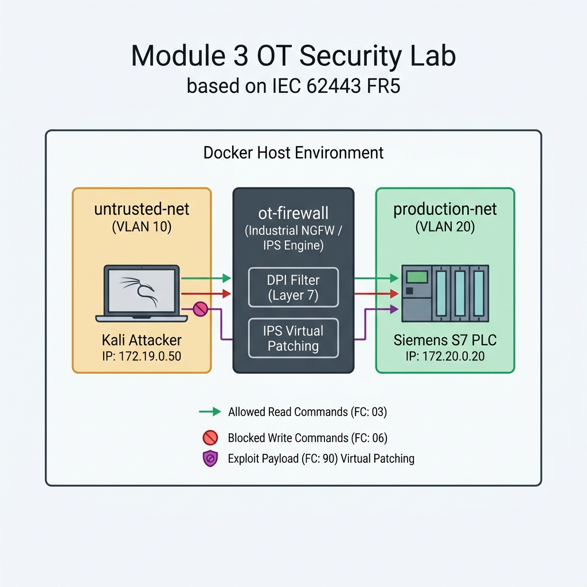

## Module 3: Industrial Firewall, Deep Packet Inspection (DPI) & Virtual Patching (IPS)

---

### 1. วัตถุประสงค์การปฏิบัติงาน (Lab Objectives)
1. **เข้าใจการแบ่งโซนเครือข่ายตามมาตรฐาน IEC 62443 FR5 (Restricted Data Flow):** เรียนรู้วิธีการใช้ Industrial Firewall ยุติสถาปัตยกรรมเครือข่ายแบบแบนราบ (Flat Network) เพื่อจำกัดการไหลของข้อมูลระหว่าง IT/Vendor Zone และ Production Zone (Zones & Conduits)
2. **ฝึกฝนการตั้งค่าคัดกรองข้อมูลเชิงลึก (Deep Packet Inspection - DPI):** เรียนรู้วิธีตรวจสอบพัสดุข้อมูลในระดับ Application Layer (Layer 7) สำหรับโปรโตคอล Modbus TCP เพื่ออนุญาตเฉพาะคำสั่งอ่านค่า (Read-Only - FC: 03) และสกัดกั้นคำสั่งแก้ไข/เขียนสั่งการเครื่องจักร (Block-Write - FC: 06/16) ช่วยป้องกันความเสี่ยงจาก Human Error หรือคำสั่งที่ไม่ได้รับอนุญาต
3. **เรียนรู้วิธีทำ Virtual Patching ด้วยระบบ IPS (Zero Downtime Protection):** เข้าใจปัญหาของเครื่องจักรรุ่นเก่า (Legacy PLC/OT Assets) ที่ไม่สามารถติดตั้ง Antivirus หรือปิดสายการผลิตเพื่ออัปเดต Firmware ได้ และฝึกฝนการกางโล่สกัดกั้นแพ็กเกจโจมตีช่องโหว่ (Firmware Exploit - FC: 90) ที่ระดับเครือข่ายด้วย IPS Signature
4. **ทดสอบจำลองภัยคุกคามและการสกัดกั้นผ่าน Docker Environment:** ฝึกฝนทักษะการสวมบทบาทเป็นทั้งแฮกเกอร์/ผู้รับเหมา (`kali-attacker`) และผู้ดูแลความปลอดภัยเครือข่าย OT (`ot-firewall`)

---

### 2. สถานการณ์จำลอง และ แผนผังเครือข่ายจำลอง (Simulated Scenario & Network Topology)

#### 📌 สถานการณ์จำลอง (Simulated Scenario)
ณ โรงงานประกอบชิ้นส่วนยานยนต์ (Automotive Assembly Plant) สายการผลิตทำงานด้วยสมองกลควบคุม Siemens S7 PLC (Modbus TCP) ซึ่งเปราะบางและมีช่องโหว่ประจำตัวระดับ Firmware (Legacy Asset) ที่ไม่ได้รับการอัปเดตเนื่องจากไม่สามารถหยุดสายการผลิตได้ (Zero Downtime Requirement)

เมื่อเร็วๆ นี้ เกิดเหตุการณ์ผู้รับเหมาภายนอก (Vendor) เชื่อมต่อคอมพิวเตอร์พกพา (Kali Linux) เข้ามาในเครือข่ายเพื่อตรวจสอบระบบ แต่เผลอส่งคำสั่งเขียนข้อมูลผิดพลาด (Human Error) จนส่งผลกระทบต่อจังหวะการทำงานของแขนกลประกอบชิ้นส่วน นอกจากนี้ยังมีความเสี่ยงจากผู้บุกรุกที่พยายามส่งแพ็กเกจโจมตีช่องโหว่ของ PLC เพื่อยึดระบบ

ผู้เรียนจะสวมบทบาทเป็น **OT Security Specialist** เพื่อนำ Next-Generation Firewall (NGFW) เข้ามาติดตั้งคั่นกลางเป็นท่อควบคุมข้อมูล (Conduit) ระหว่างเครือข่ายภายนอกกับสายการผลิต เพื่อเปิดใช้ฟีเจอร์ DPI (Read-Only Enforcement) และ IPS (Virtual Patching)

#### 📐 แผนผังเครือข่ายจำลอง (Lab Network Topology Diagram)



#### 🛠️ เครื่องมือที่ใช้ในปฏิบัติการ (Tools & Environment Overview)

* **1. Next-Gen Firewall & IPS Engine (`ot-firewall / firewall_dpi.py`):**
  * **หน้าที่:** ทำหน้าที่เป็น Industrial Firewall และระบบป้องกันการบุกรุก (IPS) อยู่ในตำแหน่ง Conduit คอยแกะพัสดุข้อมูลลึกถึงระดับ Application Layer (Layer 7) ตรวจสอบ Function Code ของ Modbus TCP และบล็อกคำสั่งอันตรายแบบเรียลไทม์
* **2. Siemens S7 PLC Honeypot (`plc-siemens`):**
  * **หน้าที่:** จำลองเป็นสมองกลควบคุมเครื่องจักร Siemens S7 PLC ในโซนปลอดภัย (Purdue Level 1) ทำหน้าที่รับคำสั่ง Modbus TCP (Port 5020/502)
* **3. Vendor / Attacker Node (`kali-attacker / send_modbus.py`):**
  * **หน้าที่:** จำลองเป็นคอมพิวเตอร์พกพาของผู้รับเหมาหรือผู้บุกรุก ใช้งานสคริปต์ `send_modbus.py` เพื่อส่งแพ็กเกจ Modbus TCP Read (FC: 03), Write (FC: 06) หรือ Exploit Payload (FC: 90) เข้าหา Firewall
* **4. Docker Bridge Networks (Zones & Conduits):**
  * **`untrusted-net` (VLAN 10 / 172.19.0.0/16):** โซนเครือข่ายภายนอก หรือ IT/Vendor Zone ที่ไม่ปลอดภัย
  * **`production-net` (VLAN 20 / 172.20.0.0/16):** โซนการผลิตภายในโรงงาน (Trusted Zone) ที่มีความสำคัญสูง

---

### 3. ขั้นตอนการเตรียมระบบก่อนเริ่มปฏิบัติงาน (Pre-Lab Reset)

⚠️ **ข้อควรระวังสำหรับผู้เรียน:** เพื่อป้องกันปัญหาพอร์ตชนกัน หรือวง Subnet `172.19.0.0/16` และ `172.20.0.0/16` ชนกับแล็บก่อนหน้า ให้สั่งล้างระบบ Docker เดิมทั้งหมดก่อนเริ่มทำ Module 3 เสมอ:

```bash
# 1. สั่งปิดและลบ Container, Volume และ Orphan Networks จากแล็บเดิม
docker compose down -v --remove-orphans

# 2. ล้าง Network ที่ไม่ได้ใช้งานใน Docker Engine
docker network prune -f

# 3. ลบ Container เก่าที่อาจค้างอยู่ในระบบ (ป้องกัน Name Conflict)
docker rm -f ot-firewall plc-siemens kali-attacker 2>/dev/null || true
```

---

### 4. ขั้นตอนการปฏิบัติงานแบบ Step-by-Step (Lab Tasks)

#### 📁 สิ่งที่ต้องจัดเตรียม (Files Needed)
ตรวจสอบไฟล์ 3 ไฟล์หลักภายในโฟลเดอร์ปฏิบัติการ `module-03-firewall-dpi`:

##### ไฟล์ที่ 1: `docker-compose.yml`
```yaml
version: '3.8'

networks:
  untrusted-net:
    driver: bridge
    ipam:
      config:
        - subnet: 172.19.0.0/16
  production-net:
    driver: bridge
    ipam:
      config:
        - subnet: 172.20.0.0/16

services:
  # 1. ระบบควบคุมจำลอง Next-Generation Firewall (NGFW/IPS Engine)
  ot-firewall:
    image: python:3.10-slim
    container_name: ot-firewall
    volumes:
      - ./firewall_dpi.py:/app/firewall_dpi.py
    working_dir: /app
    tty: true
    stdin_open: true
    command: python firewall_dpi.py
    networks:
      untrusted-net:
        ipv4_address: 172.19.0.10
      production-net:
        ipv4_address: 172.20.0.10

  # 2. เครื่องจักรเป้าหมายในโซนปลอดภัย (Siemens PLC จำลองผ่าน Conpot)
  plc-siemens:
    image: honeynet/conpot
    container_name: plc-siemens
    networks:
      production-net:
        ipv4_address: 172.20.0.20

  # 3. โน้ตบุ๊กของผู้รับเหมาหรือแฮกเกอร์ (จำลองผ่าน Python environment)
  kali-attacker:
    image: python:3.10-slim
    container_name: kali-attacker
    volumes:
      - ./send_modbus.py:/app/send_modbus.py
    working_dir: /app
    networks:
      untrusted-net:
        ipv4_address: 172.19.0.50
    tty: true
    stdin_open: true
    command: tail -f /dev/null
```

##### ไฟล์ที่ 2: `firewall_dpi.py`
```python
import socket
import threading
import sys

LISTEN_IP = "0.0.0.0"
LISTEN_PORT = 502
PLC_IP = "172.20.0.20"
PLC_PORT = 5020

ALLOW_WRITE = True                 # สิทธิ์แก้ไขค่าเครื่องจักร (Write)
IPS_VIRTUAL_PATCH_ENABLED = False  # ระบบอุดช่องโหว่เสมือน (Virtual Patching Mode)

def handle_client(client_socket):
    try:
        plc_socket = socket.socket(socket.AF_INET, socket.SOCK_STREAM)
        plc_socket.connect((PLC_IP, PLC_PORT))
    except Exception as e:
        print(f"[-] Cannot connect to PLC: {e}")
        client_socket.close()
        return

    def forward(src, dst, direction):
        global ALLOW_WRITE, IPS_VIRTUAL_PATCH_ENABLED
        try:
            while True:
                data = src.recv(4096)
                if not data:
                    break

                if direction == "inbound":
                    if len(data) >= 8:
                        function_code = data[7]

                        # [TASK 1: Deep Packet Inspection (DPI) & Granular Access Control]
                        if function_code in [6, 16]: # คำสั่งเขียนข้อมูลลง Register (Write)
                            print(f"[🛡️ DPI Alert] Detected Modbus WRITE Command (FC: {function_code})")
                            if not ALLOW_WRITE:
                                print("[🚫 Firewall Block] Policy 'Block-Write' is ACTIVE! Dropping writing command.")
                                src.send(b"\x00\x02\x00\x00\x00\x03\x01\x86\x01")
                                break

                        # [TASK 2: Virtual Patching with IPS Mode]
                        elif function_code == 90:
                            print(f"[🚨 IPS Critical Alert] Detected Exploit Payload targeting PLC Modbus firmware (FC: 90)!")
                            if IPS_VIRTUAL_PATCH_ENABLED:
                                print("[🔒 Virtual Patch Blocked] IPS virtual patch signature matched! Intercepted exploit packet. PLC remains safe.")
                                src.send(b"\x00\x03\x00\x00\x00\x03\x01\xda\x04")
                                break
                            else:
                                print("[⚠️ WARNING] Virtual Patch is DISABLED. Exploit packet forwarded to PLC SCADA!")

                        else:
                            print(f"[🟢 DPI Pass] Allowed Modbus READ Command (FC: {function_code})")

                dst.sendall(data)
        except Exception:
            pass
        finally:
            src.close()
            dst.close()

    t1 = threading.Thread(target=forward, args=(client_socket, plc_socket, "inbound"))
    t2 = threading.Thread(target=forward, args=(plc_socket, client_socket, "outbound"))
    t1.start()
    t2.start()

def main():
    global ALLOW_WRITE, IPS_VIRTUAL_PATCH_ENABLED
    server = socket.socket(socket.AF_INET, socket.SOCK_STREAM)
    server.setsockopt(socket.SOL_SOCKET, socket.SO_REUSEADDR, 1)
    server.bind((LISTEN_IP, LISTEN_PORT))
    server.listen(5)
    print(f"[*] NGFW/DPI Engine listening on {LISTEN_IP}:{LISTEN_PORT}...")
    print(f"[*] Policy State: ALLOW_WRITE={ALLOW_WRITE} | IPS_VIRTUAL_PATCH={IPS_VIRTUAL_PATCH_ENABLED}")
    while True:
        client_sock, addr = server.accept()
        print(f"[+] Active Session established with client {addr[0]}:{addr[1]}")
        threading.Thread(target=handle_client, args=(client_sock,)).start()

if __name__ == "__main__":
    if len(sys.argv) > 1:
        if "block-write" in sys.argv:
            ALLOW_WRITE = False
        if "enable-ips" in sys.argv:
            IPS_VIRTUAL_PATCH_ENABLED = True
    main()
```

##### ไฟล์ที่ 3: `send_modbus.py`
```python
import socket
import sys

IP = "172.19.0.10"
PORT = 502

def send_packet(payload):
    try:
        s = socket.socket(socket.AF_INET, socket.SOCK_STREAM)
        s.settimeout(3)
        s.connect((IP, PORT))
        s.sendall(payload)
        response = s.recv(1024)
        print(f"[*] Sent (Hex): {payload.hex()}")
        print(f"[+] Received (Hex): {response.hex()}")

        if len(response) >= 9:
            function_code = response[7]
            exception_code = response[8]
            if function_code & 0x80:
                print(f"[🚫] Server returned MODBUS EXCEPTION: {exception_code}")
                if exception_code == 1:
                    print("    ↳ Reason: Illegal Function (คำสั่งแก้ไขข้อมูลเขียนทับ ถูกบล็อกโดยระบบรักษาความปลอดภัย DPI)")
                elif exception_code == 4:
                    print("    ↳ Reason: Slave Device Failure (ตรวจพบสัญญานอันตรายเจาะช่องโหว่ ถูกสกัดโดยระบบ Virtual Patch IPS)")
            else:
                print("[🟢] Command completed successfully! (ส่งผ่านพัสดุข้อมูลสำเร็จ)")
        s.close()
    except Exception as e:
        print(f"[-] Connection Error: {e}")

def main():
    if len(sys.argv) < 2:
        print("Usage: python3 send_modbus.py [read|write|exploit]")
        sys.exit(1)

    cmd = sys.argv[1]
    if cmd == "read":
        print("[*] Sending Modbus READ HOLDING REGISTERS (FC: 03)...")
        packet = b"\x00\x01\x00\x00\x00\x06\x01\x03\x00\x00\x00\x01"
        send_packet(packet)
    elif cmd == "write":
        print("[*] Sending Modbus WRITE SINGLE REGISTER (FC: 06)...")
        packet = b"\x00\x02\x00\x00\x00\x06\x01\x06\x00\x00\x00\xff"
        send_packet(packet)
    elif cmd == "exploit":
        print("[*] Sending simulated FIRMWARE EXPLOIT packet (FC: 90)...")
        packet = b"\x00\x03\x00\x00\x00\x06\x01\x5a\xaa\xbb\xcc\xdd"
        send_packet(packet)
    else:
        print("Usage: python3 send_modbus.py [read|write|exploit]")

if __name__ == "__main__":
    main()
```

---

#### 💻 TASK 1: การจำกัดสิทธิ์ข้อมูลแบบรายละเอียด (DPI & Granular Access Control)

1. **เปิดใช้งานระบบแล็บ:**
   ```bash
   docker compose up -d
   ```

2. **ทดสอบสั่งอ่านข้อมูล PLC (Read Command - FC: 03) ในสภาวะปกติ:**
   ```bash
   docker exec -it kali-attacker python3 send_modbus.py read
   ```
   **ผลลัพธ์:** การส่งคำสั่งสำเร็จ (`DPI Pass`) เนื่องจาก Firewall อยู่ในสถานะอนุญาตปกติ และคำสั่ง Read ไม่ส่งผลกระทบต่อกระบวนการผลิต

3. **เปิดโหมด Block-Write บน Firewall เพื่อบังคับใช้สิทธิ์ Read-Only:**
   เปิดไฟล์ `docker-compose.yml` และแก้ไขคำสั่งรันบริการ `ot-firewall`:
   ```yaml
       command: python firewall_dpi.py block-write
   ```

4. **รีสตาร์ทบริการ Firewall เพื่ออัปเดตนโยบาย:**
   ```bash
   docker compose up -d ot-firewall
   ```

5. **ทดสอบสั่งเขียนข้อมูลลง PLC (Write Command - FC: 06):**
   ```bash
   docker exec -it kali-attacker python3 send_modbus.py write
   ```
   **ผลลัพธ์:** ล้มเหลว (`DPI Block`) Firewall สกัดคำสั่งเขียนทับทันที และส่งคืน Modbus Exception Code 01 (`Illegal Function`) เพื่อป้องกัน Human Error

6. **ทดสอบว่าการสั่งอ่านข้อมูลยังคงรันได้ปกติ:**
   ```bash
   docker exec -it kali-attacker python3 send_modbus.py read
   ```
   **ผลลัพธ์:** อ่านค่าได้ปกติ สะท้อนการทำ Granular Access Control ระดับ Layer 7

---

#### 🛡️ TASK 2: การอุดช่องโหว่เสมือน (Virtual Patching with IPS)

1. **ส่งแพ็กเกจโจมตีช่องโหว่ PLC (Simulated Firmware Exploit - FC: 90):**
   ```bash
   docker exec -it kali-attacker python3 send_modbus.py exploit
   ```
   **ผลลัพธ์เมื่อปิด IPS:** คำสั่งหลุดผ่านไปถึง PLC ทำให้เกิดความเสี่ยงที่สมองกลจะค้างหรือหยุดทำงาน

2. **เปิดโหมด Virtual Patching (IPS Mode):**
   แก้ไข `docker-compose.yml` ให้เปิดใช้ทั้งโหมด Block-Write และ IPS Virtual Patching:
   ```yaml
       command: python firewall_dpi.py block-write enable-ips
   ```

3. **รีสตาร์ทบริการ Firewall:**
   ```bash
   docker compose up -d ot-firewall
   ```

4. **ทดสอบส่งแพ็กเกจโจมตีช่องโหว่อีกครั้ง:**
   ```bash
   docker exec -it kali-attacker python3 send_modbus.py exploit
   ```
   **ผลลัพธ์:** ถูกบล็อกโดย IPS Virtual Patch Signature! Firewall ตรวจจับสัญญานอันตราย FC:90 และตอบกลับ Modbus Exception Code 04 (`Slave Device Failure`) สกัดภัยคุกคามก่อนวิ่งถึง PLC ช่วยปกป้องเครื่องจักรเก่าโดยไม่ต้องปิดปรับปรุง Firmware (Zero Downtime)

---

### 5. แบบทดสอบและคำถามประเมินความเข้าใจ (Comprehension & Assessment Questions)

* **❓ คำถามที่ 1: การคัดกรองแพ็กเกจด้วย Deep Packet Inspection (DPI) บน Industrial Firewall แตกต่างจากการคัดกรองด้วย Traditional Firewall (Layer 3/4) อย่างไร?**
  * **แนวคำตอบ:** Traditional Firewall ตรวจสอบเฉพาะ IP Address และ Port Number (เช่น อนุญาตให้ผ่านพอร์ต 502) แต่ไม่สามารถมองเห็นเนื้อหาคำสั่งที่อยู่ภายในแพ็กเกจได้ ในขณะที่ DPI Firewall สามารถแกะพัสดุข้อมูลลึกลงไปถึง Layer 7 (Application Layer) เพื่อตรวจสอบ Function Code ของโปรโตคอลอุตสาหกรรม (เช่น แยกแยะระหว่างคำสั่ง Read FC:03 และ Write FC:06) ทำให้สามารถกำหนดสิทธิ์การควบคุมได้อย่างละเอียด (Granular Access Control)

* **❓ คำถามที่ 2: เหตุใดเทคนิค Virtual Patching (IPS Mode) จึงมีความสำคัญอย่างยิ่งต่อการรักษาความมั่นคงปลอดภัยในโรงงานอุตสาหกรรม (OT Environment)?**
  * **แนวคำตอบ:** เนื่องจากเครื่องจักรและ PLC ในโรงงานมักเป็นอุปกรณ์รุ่นเก่า (Legacy Assets) ที่มีอายุการใช้งานยาวนาน 10-20 ปี ซึ่งเจ้าของผลิตภัณฑ์ (Vendor) อาจเลิกสนับสนุนการอัปเดต Patch แล้ว หรือการลง Patch ต้องแลกกับการหยุดสายการผลิต (Downtime) ซึ่งส่งผลกระทบต่อความพร้อมใช้งาน (Availability) การทำ Virtual Patching บน Firewall/IPS จึงเปรียบเสมือนการกางโล่ป้องกันแพ็กเกจอันตรายที่ระดับเครือข่ายก่อนจะวิ่งไปถึงตัวเครื่องจักร ทำให้ระบบปลอดภัยจากช่องโหว่โดยไม่ต้องดับเครื่องจักร (Zero Downtime)

* **❓ คำถามที่ 3: ตามมาตรฐาน IEC 62443 FR5 (Restricted Data Flow) บทบาทของ "Conduit" คืออะไร และในแล็บนี้ตัวแปรใดทำหน้าที่เป็น Conduit?**
  * **แนวคำตอบ:** "Conduit" คือช่องทางหรือท่อสื่อสารที่เชื่อมต่อระหว่างโซนความปลอดภัย (Zones) โดยมีหน้าที่บังคับใช้นโยบายความปลอดภัย คัดกรอง และจำกัดการไหลของข้อมูลระหว่างโซน ในแล็บนี้ตัวแปรที่ทำหน้าที่เป็น Conduit คือ `ot-firewall` ซึ่งทำหน้าที่คั่นกลางระหว่าง `untrusted-net` (VLAN 10) และ `production-net` (VLAN 20)

---

### 6. ขั้นตอนการล้างระบบหลังจบแล็บ (Post-Lab Cleanup)

```bash
docker compose down -v --remove-orphans
docker network prune -f
docker rm -f ot-firewall plc-siemens kali-attacker 2>/dev/null || true
```
