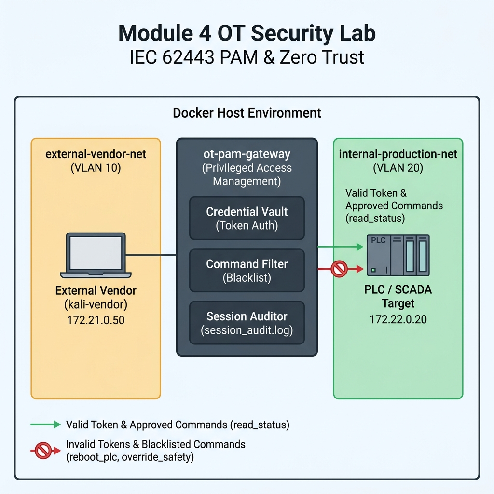

## Module 4: Secure Remote Access & Privileged Access Management (PAM) in OT

---

### 1. วัตถุประสงค์การปฏิบัติงาน (Lab Objectives)
1. **เข้าใจการสร้างระบบ Secure Remote Access ตามแนวทาง Zero Trust:** เรียนรู้วิธีการเปลี่ยนผ่านจากการใช้ VPN แบบเปิดวงกว้าง (Broad-network VPN) ซึ่งเสี่ยงต่อการถูกใช้เป็นช่องทางเกาะตาม (Pivot Attack) ไปสู่การบังคับผ่านประตูกลาง (PAM Gateway / Jump Server)
2. **ฝึกฝนการควบคุมสิทธิ์ขั้นต่ำ (Principle of Least Privilege):** เรียนรู้วิธีการซ่อนข้อมูลรหัสผ่านจริง (Credential Cloaking) ของอุปกรณ์ PLC / SCADA จากผู้รับเหมาภายนอก โดยให้สิทธิ์เข้าถึงเฉพาะฟังก์ชันที่ได้รับอนุญาตเท่านั้น
3. **ตั้งค่าระบบคัดกรองคำสั่งอนุมัติแบบเรียลไทม์ (Real-time Command Filtering):** ฝึกตั้งค่ากฎสกัดกั้นคำสั่งอันตราย (Blacklisted Commands) เช่น การรีเซ็ตค่าเครื่องจักร การสั่ง Stop PLC หรือการลบไฟล์คอนฟิก
4. **เรียนรู้การบันทึกการทำงานเพื่อการตรวจสอบย้อนหลัง (Session Recording & Audit Logging):** เข้าใจกลไกการบันทึกประวัติคำสั่งทุกขั้นตอน (Audit Trail) เพื่อใช้ในการตรวจสอบเมื่อเกิดเหตุการณ์ผิดปกติในสายการผลิต

---

### 2. สถานการณ์จำลอง และ แผนผังเครือข่ายจำลอง (Simulated Scenario & Network Topology)

#### 📌 สถานการณ์จำลอง (Simulated Scenario)
ณ โรงงานประกอบชิ้นส่วนยานยนต์ (Automotive Assembly Plant) มีความจำเป็นต้องเปิดให้ผู้รับเหมาภายนอก (System Integrator / Vendor) รีโมทเข้ามาบำรุงรักษาและแก้ไขซอฟต์แวร์ของระบบ SCADA และ PLC ผ่านอินเทอร์เน็ต แต่ในอดีตโรงงานเคยประสบปัญหาวิลเลจเกตเวย์ VPN เปิดวงกว้างจนทำให้เครื่องผู้รับเหมาที่มีมัลแวร์ติดเข้ามาแพร่กระจายสู่เครือข่ายสายการผลิต

ผู้เรียนจะสวมบทบาทเป็น **OT Security Administrator** ในการจัดตั้งระบบประตูกลาง `ot-pam-gateway` เพื่อควบคุม คัดกรองคำสั่งอันตราย และบันทึกการทำงานของผู้รับเหมาภายนอก (`kali-vendor`) ก่อนที่สัญญาณจะถูกส่งไปยัง `plc-scada` ในโซนการผลิต

#### 📐 แผนผังเครือข่ายจำลอง (Lab Network Topology Diagram)



#### 🛠️ เครื่องมือที่ใช้ในปฏิบัติการ (Tools & Environment Overview)

* **1. PAM Gateway (`ot-pam-gateway / pam_gateway.py`):**
  * **หน้าที่:** ประตูกลางควบคุมการเข้าถึงสิทธิ์สูง (Privileged Access Management) ทำหน้าที่ซ่อนรหัสผ่านจริง (Credential Vault), ตรวจสอบสิทธิ์ด้วย Token, คัดกรองคำสั่งอันตราย (Command Blacklist) และบันทึก Audit Logs ลงไฟล์ `session_audit.log`
* **2. PLC SCADA Target (`plc-scada`):**
  * **หน้าที่:** จำลองเป็นเครื่องจักรหรือสมองกล PLC ในโซนควบคุมการผลิต (Purdue Level 1-2) ที่ต้องการความคุ้มครองจากการรีโมทโดยตรง
* **3. External Vendor Client (`kali-vendor / vendor_client.py`):**
  * **หน้าที่:** จำลองเป็นคอมพิวเตอร์พกพาของผู้รับเหมาภายนอก (Vendor Laptop) ใช้งานสคริปต์ `vendor_client.py` เพื่อเชื่อมต่อผ่าน PAM Gateway
* **4. Docker Bridge Networks (Virtual VLANs):**
  * **`external-vendor-net` (VLAN 10 / 172.21.0.0/16):** โซนภายนอกโรงงานสำหรับผู้รับเหมาภายนอก
  * **`internal-production-net` (VLAN 20 / 172.22.0.0/16):** โซนการผลิตภายใน (Trusted Zone)

---

### 3. ขั้นตอนการเตรียมระบบก่อนเริ่มปฏิบัติงาน (Pre-Lab Reset)

เปิด Terminal ในโฟลเดอร์ปฏิบัติการ แล้วรันคำสั่งเคลียร์ระบบเก่า:

```bash
# 1. สั่งปิดและลบ Container, Volume และ Orphan Networks จากแล็บเดิม
docker compose down -v --remove-orphans

# 2. ล้าง Network ที่ไม่ได้ใช้งานใน Docker Engine เพื่อป้องกันพอร์ตชนกัน
docker network prune -f

# 3. ลบ Container เก่าที่อาจค้างอยู่ในระบบ (ป้องกัน Name Conflict)
docker rm -f ot-pam-gateway plc-scada kali-vendor 2>/dev/null || true
```

---

### 4. ขั้นตอนการปฏิบัติงานแบบ Step-by-Step (Lab Tasks)

#### 📁 สิ่งที่ต้องจัดเตรียม (Files Needed)
ตรวจสอบไฟล์ 3 ไฟล์หลักภายในโฟลเดอร์ปฏิบัติการ `module-04-pam-remote-access`:

##### ไฟล์ที่ 1: `docker-compose.yml`
```yaml
version: '3.8'

networks:
  external-vendor-net:
    driver: bridge
    ipam:
      config:
        - subnet: 172.21.0.0/16
  internal-production-net:
    driver: bridge
    ipam:
      config:
        - subnet: 172.22.0.0/16

services:
  # 1. ประตูกลาง PAM (Privileged Access Management Gateway)
  ot-pam-gateway:
    image: python:3.10-slim
    container_name: ot-pam-gateway
    volumes:
      - ./pam_gateway.py:/app/pam_gateway.py
    working_dir: /app
    tty: true
    stdin_open: true
    command: python pam_gateway.py
    networks:
      external-vendor-net:
        ipv4_address: 172.21.0.10
      internal-production-net:
        ipv4_address: 172.22.0.10

  # 2. เครื่องจักรเป้าหมายในโซนการผลิต (PLC/SCADA Target)
  plc-scada:
    image: honeynet/conpot
    container_name: plc-scada
    networks:
      internal-production-net:
        ipv4_address: 172.22.0.20

  # 3. โน้ตบุ๊กของผู้รับเหมาภายนอก (External Vendor / Python environment)
  kali-vendor:
    image: python:3.10-slim
    container_name: kali-vendor
    volumes:
      - ./vendor_client.py:/app/vendor_client.py
    working_dir: /app
    networks:
      external-vendor-net:
        ipv4_address: 172.21.0.50
    tty: true
    stdin_open: true
    command: tail -f /dev/null
```

##### ไฟล์ที่ 2: `pam_gateway.py`
```python
import socket
import threading
import sys
import datetime

LISTEN_IP = "0.0.0.0"
LISTEN_PORT = 9022
PLC_IP = "172.22.0.20"
PLC_PORT = 502

# Credential Vault จำลอง (ชี้แจงสิทธิ์ Vendor)
VALID_VENDOR_TOKEN = "VENDOR-SECRET-KEY-99"

# รายการคำสั่งอันตรายที่ห้าม Vendor สั่งงาน (Command Blacklist)
DANGEROUS_COMMANDS = ["reboot_plc", "override_safety", "stop_production", "clear_logs"]

def log_audit(vendor_ip, action, status, details=""):
    timestamp = datetime.datetime.now().strftime("%Y-%m-%d %H:%M:%S")
    log_line = f"[{timestamp}] [VENDOR: {vendor_ip}] ACTION: {action} | STATUS: {status} | DETAILS: {details}\n"
    print(log_line.strip())
    with open("session_audit.log", "a", encoding="utf-8") as f:
        f.write(log_line)

def handle_vendor_session(client_sock, addr):
    vendor_ip = addr[0]
    log_audit(vendor_ip, "SESSION_CONNECT", "INFO", "Vendor connected to PAM Gateway")

    try:
        client_sock.sendall(b"=== OT-PAM GATEWAY ACCESS ===\nPlease enter Vendor Session Token: ")
        token = client_sock.recv(1024).decode('utf-8', errors='ignore').strip()

        if token != VALID_VENDOR_TOKEN:
            log_audit(vendor_ip, "AUTHENTICATION", "DENIED", "Invalid Vendor Token provided")
            client_sock.sendall("\n[🚫 PAM ERROR] Authentication Failed: Invalid Token. Session Terminated.\n".encode('utf-8'))
            client_sock.close()
            return

        log_audit(vendor_ip, "AUTHENTICATION", "SUCCESS", "Vendor identity verified. Vault credential injected.")
        client_sock.sendall("\n[🟢 PAM AUTH OK] Authenticated successfully.\nConnected to PLC-SCADA via Secure Vault Proxy.\nCommands available: read_status, calibrate_sensor, reboot_plc, override_safety\nEnter command (or 'exit'): ".encode('utf-8'))

        while True:
            cmd = client_sock.recv(1024).decode('utf-8', errors='ignore').strip()
            if not cmd or cmd.lower() == 'exit':
                log_audit(vendor_ip, "SESSION_DISCONNECT", "INFO", "Vendor closed session")
                break

            # [Real-time Command Filtering]
            if cmd in DANGEROUS_COMMANDS:
                log_audit(vendor_ip, f"COMMAND: {cmd}", "BLOCKED", "Triggered PAM Security Rules (Dangerous Command)")
                client_sock.sendall(f"\n[🚫 PAM SECURITY BLOCK] Command '{cmd}' is BLACKLISTED for Vendor accounts!\nEnter command: ".encode('utf-8'))
            else:
                # ส่งคำสั่งจำลองต่อไปยัง PLC ปลายทาง
                log_audit(vendor_ip, f"COMMAND: {cmd}", "EXECUTED", "Forwarded through secure proxy to PLC")
                client_sock.sendall(f"\n[🟢 SUCCESS] Command '{cmd}' executed on PLC-SCADA successfully.\nEnter command: ".encode('utf-8'))

    except Exception as e:
        log_audit(vendor_ip, "SESSION_ERROR", "ERROR", str(e))
    finally:
        client_sock.close()

def main():
    server = socket.socket(socket.AF_INET, socket.SOCK_STREAM)
    server.setsockopt(socket.SOL_SOCKET, socket.SO_REUSEADDR, 1)
    server.bind((LISTEN_IP, LISTEN_PORT))
    server.listen(5)
    print(f"[*] OT-PAM Gateway listening on {LISTEN_IP}:{LISTEN_PORT}...")
    while True:
        client_sock, addr = server.accept()
        threading.Thread(target=handle_vendor_session, args=(client_sock, addr)).start()

if __name__ == "__main__":
    main()
```

##### ไฟล์ที่ 3: `vendor_client.py`
```python
import socket
import sys
import time

PAM_IP = "172.21.0.10"
PAM_PORT = 9022

def run_vendor_client(token, command_to_run):
    try:
        s = socket.socket(socket.AF_INET, socket.SOCK_STREAM)
        s.connect((PAM_IP, PAM_PORT))

        # รับข้อความต้อนรับ
        banner = s.recv(1024).decode('utf-8')
        print(banner, end="")

        # ส่ง Token ยืนยันตัวตน
        s.sendall(token.encode('utf-8') + b"\n")
        auth_resp = s.recv(1024).decode('utf-8')
        print(auth_resp)

        if "AUTH OK" in auth_resp:
            time.sleep(0.5)
            print(f"[*] Sending Vendor Command: '{command_to_run}'")
            s.sendall(command_to_run.encode('utf-8') + b"\n")
            cmd_resp = s.recv(1024).decode('utf-8')
            print(cmd_resp)

            s.sendall(b"exit\n")
        s.close()
    except Exception as e:
        print(f"[-] Connection Error: {e}")

def main():
    if len(sys.argv) < 3:
        print("Usage: python3 vendor_client.py [TOKEN] [COMMAND]")
        print("Example: python3 vendor_client.py VENDOR-SECRET-KEY-99 read_status")
        sys.exit(1)

    token = sys.argv[1]
    cmd = sys.argv[2]
    run_vendor_client(token, cmd)

if __name__ == "__main__":
    main()
```

---

#### 🛠️ TASK 1: Secure Remote Access & Least Privilege Enforcement

1. **เปิดใช้งานระบบแล็บ:**
   ```bash
   docker compose up -d
   ```

2. **ทดสอบเชื่อมต่อโดยระบุ Token ผิดพลาด (Unauthenticated Remote Access Test):**
   ```bash
   docker exec -it kali-vendor python3 vendor_client.py INVALID-KEY read_status
   ```
   **ผลลัพธ์:** ล้มเหลว (`PAM Error`) PAM Gateway ไม่อนุญาตให้ผ่านเข้าสู่ระบบ และทำการตัด Session ทันที

3. **ทดสอบเชื่อมต่อสำเร็จด้วยสิทธิ์ Vendor (Authenticated Remote Session):**
   ```bash
   docker exec -it kali-vendor python3 vendor_client.py VENDOR-SECRET-KEY-99 read_status
   ```
   **ผลลัพธ์:** สำเร็จ (`PAM AUTH OK`) Vendor สามารถส่งคำสั่ง `read_status` ได้ โดยที่ไม่รู้รหัสผ่านจริงของเครื่อง `plc-scada` ปลายทาง

---

#### 🛡️ TASK 2: Real-time Command Filtering & Session Audit

1. **ทดสอบสั่งคำสั่งอันตรายเพื่อทดสอบ Command Blacklist (Dangerous Command Injection):**
   ทดลองส่งคำสั่ง `reboot_plc` หรือ `override_safety`:
   ```bash
   docker exec -it kali-vendor python3 vendor_client.py VENDOR-SECRET-KEY-99 reboot_plc
   ```
   **ผลลัพธ์:** ถูกสกัดกั้นทันที (`PAM SECURITY BLOCK`) คำสั่งอันตรายถูกคัดกรองทิ้ง และไม่ถูกส่งต่อไปยัง `plc-scada`

2. **ตรวจสอบประวัติและบันทึกความปลอดภัย (Audit Log Verification):**
   ตรวจสอบไฟล์บันทึกประวัติการทำงานบน PAM Gateway:
   ```bash
   docker exec -it ot-pam-gateway cat session_audit.log
   ```
   **สังเกตผลลัพธ์:** ปรากฏบันทึก Time-stamp, ไอพีผู้รับเหมา, สถานะผ่านการยืนยันตัวตน และธงแจ้งเตือน `[BLOCKED]` เมื่อมีการพยายามสั่งคำสั่ง `reboot_plc`

---

### 5. แบบทดสอบและคำถามประเมินความเข้าใจ (Comprehension & Assessment Questions)

* **❓ คำถามที่ 1: การใช้ Privileged Access Management (PAM) มีความได้เปรียบกว่าการให้ผู้รับเหมาเชื่อมต่อผ่าน VPN แบบทั่วไป (Site-to-Site / Dial-up VPN) ในระบบ OT อย่างไร?**
  * **แนวคำตอบ:** การใช้ VPN แบบทั่วไปจะทำให้อุปกรณ์ของผู้รับเหมาเข้ามาอยู่ในวงเครือข่ายเดียวกับระบบ OT (Network Layer) ซึ่งหากเครื่องผู้รับเหมาติดมัลแวร์ มัลแวร์จะสามารถสแกนและแพร่กระจายไปหา PLC เครื่องอื่นในวงได้ทันที แต่ระบบ PAM ทำหน้าที่เป็นประตูกลางในระดับ Application Layer ช่วยซ่อนโครงสร้างเครือข่ายภายใน ซ่อนรหัสผ่านจริง (Credential Vault) และจำกัดสิทธิ์ให้รีโมทได้เฉพาะเครื่องที่ได้รับอนุมัติเท่านั้น

* **❓ คำถามที่ 2: เหตุใดการบันทึกประวัติการทำงาน (Session Recording / Audit Logging) จึงเป็นข้อกำหนดบังคับที่สำคัญในมาตรฐาน IEC 62443?**
  * **แนวคำตอบ:** เนื่องจากเมื่อเกิดเหตุการณ์เครื่องจักรหยุดทำงานหรือเกิดความเสียหายในสายการผลิต (Incidents) ข้อมูล Audit Log จาก PAM จะเป็นหลักฐานสำคัญ (Digital Forensics) ในการพิสูจน์ยืนยันตัวบุคคล คำสั่งที่ถูกส่ง และช่วงเวลาที่เกิดเหตุ ช่วยแยกแยะระหว่างข้อผิดพลาดจากคน (Human Error) กับการถูกโจมตีทางไซเบอร์ได้อย่างชัดเจน

* **❓ คำถามที่ 3: หากผู้รับเหมามีความจำเป็นต้องส่งคำสั่งระดับสูง (เช่น การอัปเดต Firmware PLC) ในทางปฏิบัติควรมีกระบวนการอย่างไรบนระบบ PAM?**
  * **แนวคำตอบ:** ต้องใช้กระบวนการขออนุมัติใช้งานสิทธิ์ชั่วคราว (Just-In-Time Access / Dual-Control Approval) โดยผู้รับเหมาต้องยื่นคำขอพร้อมระบุช่วงเวลา และต้องได้รับการอนุมัติจากวิศวกรควบคุมโรงงาน (OT Plant Manager) ก่อน ระบบ PAM จึงจะปลดล็อกคำสั่งพิเศษนั้นให้ใช้งานได้ในช่วงเวลาที่กำหนดเท่านั้น

---

### 6. ขั้นตอนการล้างระบบหลังจบแล็บ (Post-Lab Cleanup)

```bash
docker compose down -v --remove-orphans
docker network prune -f
docker rm -f ot-pam-gateway plc-scada kali-vendor 2>/dev/null || true
```
