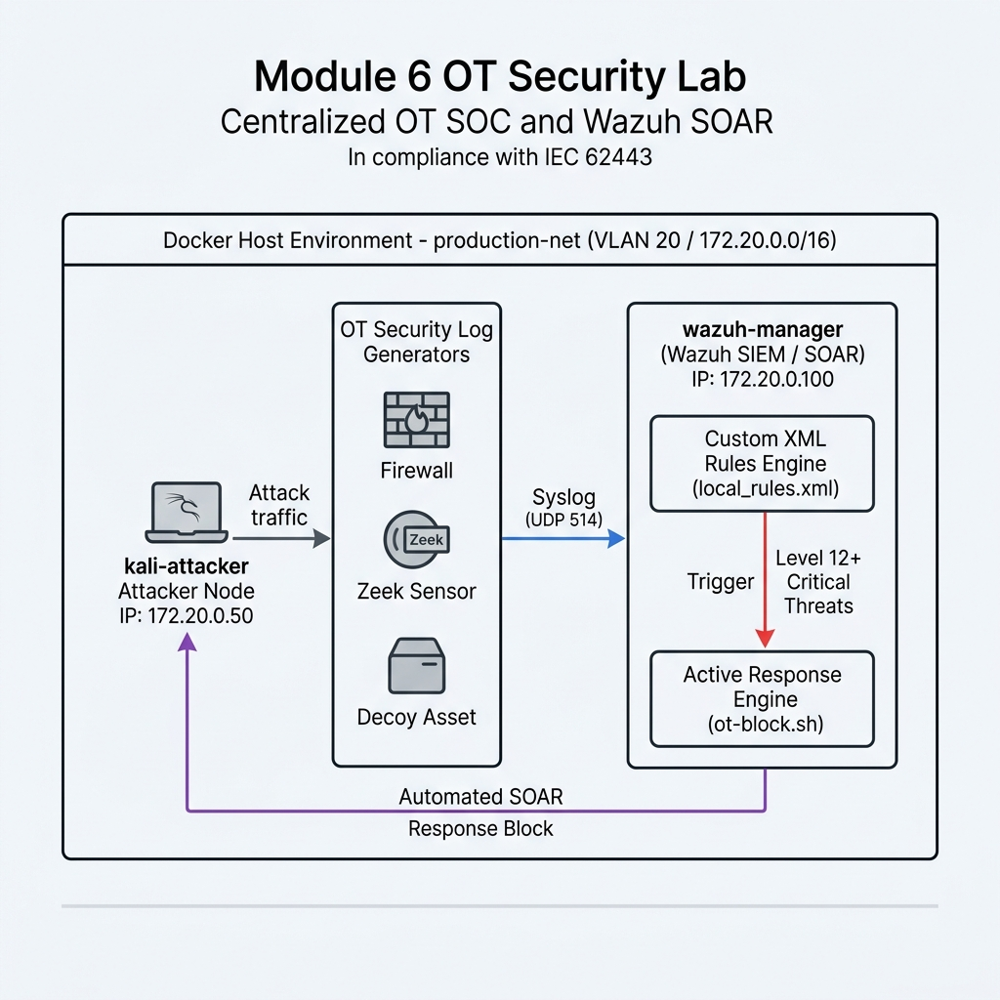

## Module 6: Centralized OT SOC, SIEM (Wazuh) & Automated Active Response (SOAR)

---

### 1. วัตถุประสงค์การปฏิบัติงาน (Lab Objectives)
1. **เข้าใจสถาปัตยกรรมศูนย์เฝ้าระวังภัยคุกคาม OT (OT SOC Architecture):** เรียนรู้การรวบรวมข้อมูล Log สัมพันธ์ข้ามระบบ (Centralized Log Aggregation) จากอุปกรณ์ความปลอดภัยในสายการผลิต (Firewall, Zeek Sensor, PAM Gateway, Deception Honeypot) เข้าสู่ศูนย์กลางด้วยโปรโตคอล Syslog (UDP 514)
2. **ฝึกฝนเขียนกฎตรวจจับภัยคุกคามโปรโตคอลอุตสาหกรรม (Wazuh Custom Rules):** เรียนรู้การเขียนโครงสร้างไฟล์ `local_rules.xml` บน Wazuh เพื่อวิเคราะห์และดักจับเหตุการณ์ผิดปกติ เช่น การพยายามเขียนสั่งการ PLC (Modbus Write), การเข้าถึงเครื่องเหยื่อล่อ (Decoy Asset), และการยิง Exploit
3. **ติดตั้งและเปิดใช้ระบบสกัดกั้นอัตโนมัติ (Wazuh Active Response / SOAR):** พัฒนาสคริปต์ตอบสนองภัยคุกคามอัตโนมัติ เพื่อตัดการเชื่อมต่อหรือบล็อก IP ผู้บุกรุกทันทีที่ทริกเกอร์ Rule ระดับ Critical Alert ช่วยลดระยะเวลาตอบสนองต่อเหตุการณ์ (MTTR) ให้เหลือระดับวินาที
4. **ฝึกสืบค้นพยานหลักฐานดิจิทัล (Digital Forensics & SIEM Dashboard):** เรียนรู้การใช้งานระบบ SIEM ในการวิเคราะห์ลำดับเหตุการณ์การโจมตี (Attack Timeline) ตามมาตรฐาน IEC 62443

---

### 2. สถานการณ์จำลอง และ แผนผังเครือข่ายจำลอง (Simulated Scenario & Network Topology)

#### 📌 สถานการณ์จำลอง (Simulated Scenario)
ณ โรงงานผลิตชิ้นส่วนยานยนต์ไฮบริด (Hybrid Automotive Manufacturing Facility) แม้โรงงานจะมีการติดตั้งอุปกรณ์ความปลอดภัยหลายชั้น (Firewall, Zeek, Deception, PAM) แต่ข้อมูล Log จากแต่ละอุปกรณ์ยังคงทำงานแบบแยกส่วน (Security Silos) ทำให้เมื่อเกิดเหตุการณ์บุกรุก ทีมวิศวกรใช้เวลาหลายชั่วโมงในการสืบค้นสาเหตุ

ผู้เรียนจะสวมบทบาทเป็น **OT SOC Analyst** ในการรวบรวม Log จากทุกอุปกรณ์เข้าสู่ Wazuh SIEM Manager และตั้งค่าระบบ Wazuh Active Response เพื่อให้สั่งการบล็อก IP ของแฮกเกอร์แบบอัตโนมัติทันทีที่มีการแตะต้องเครื่องเหยื่อล่อ หรือพยายามยิง Exploit ใส่ PLC สายการผลิต

#### 📐 แผนผังเครือข่ายจำลอง (Lab Network Topology Diagram)



#### 🛠️ เครื่องมือที่ใช้ในปฏิบัติการ (Tools & Environment Overview)

* **1. Wazuh Manager SIEM & SOAR Engine (`wazuh-manager` / [`wazuh_sim.py`](https://github.com/watchara-sukka/learninghub/blob/main/ot-security/module-06-wazuh-soc/wazuh_sim.py) - IP: 172.20.0.100):**
  * **หน้าที่:** ระบบศูนย์กลางเฝ้าระวังภัยคุกคาม รวบรวม Syslog (UDP 514), ประมวลผลกฎ Custom XML Rules ([`local_rules.xml`](https://github.com/watchara-sukka/learninghub/blob/main/ot-security/module-06-wazuh-soc/rules/local_rules.xml)) และสั่งการระบบตอบสนองอัตโนมัติ (SOAR) ผ่านสคริปต์ [`ot-block.sh`](https://github.com/watchara-sukka/learninghub/blob/main/ot-security/module-06-wazuh-soc/active-response/bin/ot-block.sh)
* **2. Wazuh Custom XML Rules ([`rules/local_rules.xml`](https://github.com/watchara-sukka/learninghub/blob/main/ot-security/module-06-wazuh-soc/rules/local_rules.xml)):**
  * **หน้าที่:** ชุดกฎตรวจจับภัยคุกคามเฉพาะทาง OT แบ่งเป็น:
    * **Rule 100001 (Level 8):** ตรวจจับคำสั่ง Modbus Write
    * **Rule 100002 (Level 12):** ตรวจจับการแตะต้อง Decoy Asset
    * **Rule 100003 (Level 14):** ตรวจจับการยิง Firmware Exploit (FC: 90)
* **3. Active Response Script ([`active-response/bin/ot-block.sh`](https://github.com/watchara-sukka/learninghub/blob/main/ot-security/module-06-wazuh-soc/active-response/bin/ot-block.sh)):**
  * **หน้าที่:** สคริปต์ตอบสนองอัตโนมัติ ทำหน้าที่สั่งบล็อก IP ของแฮกเกอร์ (`172.20.0.50`) ทันทีที่ทริกเกอร์ Rule ระดับ 12 ขึ้นไป พร้อมบันทึกหลักฐานลง `/var/ossec/logs/active-responses.log`
* **4. OT Log Generator (`ot-log-sender` / [`ot_log_generator.py`](https://github.com/watchara-sukka/learninghub/blob/main/ot-security/module-06-wazuh-soc/ot_log_generator.py) - IP: 172.20.0.10):**
  * **หน้าที่:** จำลองเซ็นเซอร์และอุปกรณ์ในสายการผลิตที่ทำการส่ง Syslog (RFC3164) เข้าสู่ Wazuh SIEM
* **5. Attacker Simulator (`kali-attacker` / [`attack_sim.py`](https://github.com/watchara-sukka/learninghub/blob/main/ot-security/module-06-wazuh-soc/attack_sim.py) - IP: 172.20.0.50):**
  * **หน้าที่:** จำลองเครื่องของผู้บุกรุก ใช้งานสคริปต์ `attack_sim.py` ยิงเหตุการณ์การโจมตีรูปแบบต่างๆ เข้าหา Wazuh SIEM

---

### 3. ขั้นตอนการเตรียมระบบก่อนเริ่มปฏิบัติงาน (Pre-Lab Reset)

⚠️ **ข้อควรระวังสำหรับผู้เรียน:** สั่งล้าง Container, Volume และ Docker Network เก่าเพื่อป้องกันปัญหาพอร์ต Syslog UDP 514 หรือพอร์ตชนกันก่อนเริ่มทำแล็บเสมอ:

```bash
# 1. สั่งปิดและลบ Container, Volume และ Orphan Networks จากแล็บเดิม
docker compose down -v --remove-orphans

# 2. ล้าง Network ที่ไม่ได้ใช้งานใน Docker Engine
docker network prune -f

# 3. ลบ Container เก่าที่อาจค้างอยู่ในระบบ (ป้องกัน Name Conflict)
docker rm -f wazuh-manager ot-log-sender kali-attacker 2>/dev/null || true
```

---

### 4. ขั้นตอนการปฏิบัติงานแบบ Step-by-Step (Lab Tasks)

#### 📁 สิ่งที่ต้องจัดเตรียม (Prerequisites & Files Needed)
สร้างโฟลเดอร์และสร้างโครงสร้างไฟล์ที่กำหนดภายใน `module-06-wazuh-soc`:

```bash
mkdir -p rules active-response/bin
```

##### ไฟล์ที่ 1: [`docker-compose.yml`](https://github.com/watchara-sukka/learninghub/blob/main/ot-security/module-06-wazuh-soc/docker-compose.yml)
```yaml
version: '3.8'

networks:
  production-net:
    driver: bridge
    ipam:
      config:
        - subnet: 172.20.0.0/16

services:
  # 1. Wazuh Manager & SIEM Engine (จำลองระบบประมวลผล Log และ SOAR)
  wazuh-manager:
    image: python:3.10-slim
    container_name: wazuh-manager
    hostname: wazuh-manager
    ports:
      - "514:514/udp"   # Syslog Port สำหรับรับ Log จากอุปกรณ์ OT
      - "55000:55000"   # Wazuh API Port
    volumes:
      - ./rules/local_rules.xml:/var/ossec/etc/rules/local_rules.xml:ro
      - ./active-response/bin/ot-block.sh:/var/ossec/active-response/bin/ot-block.sh:ro
      - ./wazuh_sim.py:/app/wazuh_sim.py
    working_dir: /app
    tty: true
    stdin_open: true
    command: python wazuh_sim.py
    networks:
      production-net:
        ipv4_address: 172.20.0.100

  # 2. เซ็นเซอร์และอุปกรณ์ส่ง Log ในเครือข่าย OT (OT Security Log Generators)
  ot-log-sender:
    image: python:3.10-slim
    container_name: ot-log-sender
    volumes:
      - ./ot_log_generator.py:/app/ot_log_generator.py
    working_dir: /app
    tty: true
    stdin_open: true
    command: python ot_log_generator.py
    networks:
      production-net:
        ipv4_address: 172.20.0.10

  # 3. เครื่องผู้บุกรุก / แฮกเกอร์ (Kali Linux Attacker / Python environment)
  kali-attacker:
    image: python:3.10-slim
    container_name: kali-attacker
    volumes:
      - ./attack_sim.py:/app/attack_sim.py
    working_dir: /app
    tty: true
    stdin_open: true
    command: tail -f /dev/null
    networks:
      production-net:
        ipv4_address: 172.20.0.50
```

##### ไฟล์ที่ 2: [`rules/local_rules.xml`](https://github.com/watchara-sukka/learninghub/blob/main/ot-security/module-06-wazuh-soc/rules/local_rules.xml)
```xml
<group name="ot,industrial_security,">

  <!-- Rule 1: ตรวจจับการพยายามเขียนสั่งการ PLC (Modbus Write) -->
  <rule id="100001" level="8">
    <field name="message">Modbus WRITE Command</field>
    <description>OT Warning: Unauthorized Modbus WRITE command detected targeting PLC!</description>
    <mitre>
      <id>T0855</id> <!-- MITRE ATT&CK for ICS: Unauthorized Command Message -->
    </mitre>
  </rule>

  <!-- Rule 2: ตรวจจับการแตะต้องเครื่องเหยื่อล่อ (Decoy Asset Access) -->
  <rule id="100002" level="12">
    <field name="message">DECOY_PLC_TOUCHED</field>
    <description>CRITICAL OT ALERT: Intruder interacting with Decoy PLC Asset (172.20.0.99)!</description>
    <mitre>
      <id>T0846</id> <!-- MITRE ATT&CK for ICS: Remote System Discovery -->
    </mitre>
  </rule>

  <!-- Rule 3: ตรวจจับการยิง Exploit ช่องโหว่สมองกล (Firmware Exploit FC 90) -->
  <rule id="100003" level="14">
    <field name="message">EXPLOIT_FC90_DETECTED</field>
    <description>CRITICAL OT ALERT: Modbus Firmware Exploit Payload (FC: 90) intercepted!</description>
  </rule>

</group>
```

##### ไฟล์ที่ 3: [`active-response/bin/ot-block.sh`](https://github.com/watchara-sukka/learninghub/blob/main/ot-security/module-06-wazuh-soc/active-response/bin/ot-block.sh)
```bash
#!/bin/bash
# Wazuh Active Response script for OT Automated Threat Blocking

LOG_FILE="/var/ossec/logs/active-responses.log"
INPUT=$(cat)

# Extract srcip or attacker IP from alert JSON
ATTACKER_IP=$(echo "$INPUT" | grep -oE '"srcip":"[0-9.]+"' | cut -d'"' -f4)

if [ -z "$ATTACKER_IP" ]; then
    ATTACKER_IP="172.20.0.50"
fi

TIMESTAMP=$(date "+%Y-%m-%d %H:%M:%S")
echo "[$TIMESTAMP] [⚡ WAZUH ACTIVE RESPONSE EXECUTED] Blocked IP $ATTACKER_IP (Triggered Rule Level 12+ OT Threat)" >> "$LOG_FILE"
echo "[$TIMESTAMP] Active Response Executed: Blocked IP $ATTACKER_IP" >> "$LOG_FILE"
```

##### ไฟล์ที่ 4: [`ot_log_generator.py`](https://github.com/watchara-sukka/learninghub/blob/main/ot-security/module-06-wazuh-soc/ot_log_generator.py)
```python
import socket
import time
import sys

WAZUH_IP = "172.20.0.100"
SYSLOG_PORT = 514

def send_syslog(message):
    try:
        sock = socket.socket(socket.AF_INET, socket.SOCK_DGRAM)
        # ฟอร์แมต Syslog RFC3164
        syslog_msg = f"<134>1 {time.strftime('%Y-%m-%dT%H:%M:%SZ')} OT-SECURITY-GW {message}"
        sock.sendto(syslog_msg.encode('utf-8'), (WAZUH_IP, SYSLOG_PORT))
        print(f"[📡 Syslog Sent -> Wazuh] {message}")
        sock.close()
    except Exception as e:
        print(f"[-] Error sending syslog: {e}")

def main():
    print("[*] OT Security Log Collector Engine running... Connected to Wazuh SIEM.")
    sys.stdout.flush()
    while True:
        time.sleep(1)

if __name__ == "__main__":
    main()
```

##### ไฟล์ที่ 5: [`attack_sim.py`](https://github.com/watchara-sukka/learninghub/blob/main/ot-security/module-06-wazuh-soc/attack_sim.py)
```python
import socket
import time
import sys

WAZUH_IP = "172.20.0.100"
SYSLOG_PORT = 514

def send_event(msg):
    sock = socket.socket(socket.AF_INET, socket.SOCK_DGRAM)
    syslog_msg = f"<134>1 {time.strftime('%Y-%m-%dT%H:%M:%SZ')} kali-attacker {msg}"
    sock.sendto(syslog_msg.encode('utf-8'), (WAZUH_IP, SYSLOG_PORT))
    print(f"[💥 Attack Action Executed] Sent syslog: {msg}")
    sock.close()

def main():
    if len(sys.argv) < 2:
        print("Usage: python3 attack_sim.py [scan|modbus-write|touch-decoy|exploit]")
        sys.exit(1)

    cmd = sys.argv[1]
    if cmd == "scan":
        send_event("OT_SCAN: Port 502 Modbus scanning detected from 172.20.0.50")
    elif cmd == "modbus-write":
        send_event("Modbus WRITE Command (FC: 06) sent to PLC 172.20.0.20 from 172.20.0.50")
    elif cmd == "touch-decoy":
        send_event("DECOY_PLC_TOUCHED: Unauthorized connection to Decoy PLC (172.20.0.99) from 172.20.0.50")
    elif cmd == "exploit":
        send_event("EXPLOIT_FC90_DETECTED: Critical Exploit Payload (FC: 90) targeting PLC 172.20.0.20 from 172.20.0.50")
    else:
        print("Invalid choice!")

if __name__ == "__main__":
    main()
```

---

#### 🛠️ TASK 1: การเริ่มต้นระบบ Wazuh SIEM และการตรวจสอบการรับ Syslog

1. **สตาร์ทระบบแล็บด้วย Docker Compose:**
   ```bash
   docker compose up -d
   ```

2. **ตรวจสอบสถานะการทำงานของ Wazuh Manager:**
   ```bash
   docker logs -f wazuh-manager
   ```
   **ผลลัพธ์:** จะพบข้อความการโหลดกฎ `local_rules.xml` และการเปิดพอร์ตรับสัญญาณ Syslog บน UDP 514

---

#### 🛠️ TASK 2: การทดสอบยิงเหตุการณ์การโจมตีและการวิเคราะห์ผลบน Wazuh SIEM

1. **ทดสอบยิงเหตุการณ์สแกนเครือข่าย (Low Priority Event):**
   ```bash
   docker exec -it kali-attacker python3 attack_sim.py scan
   ```
   **ผลลัพธ์บน Wazuh:** บันทึกเป็น Log ทั่วไป (`Level 3 Info`) ไม่เกิดแจ้งเตือนรุนแรง

2. **ทดสอบส่งคำสั่งเขียนค่าลง PLC (Modbus Write - Level 8 Warning):**
   ```bash
   docker exec -it kali-attacker python3 attack_sim.py modbus-write
   ```
   **ผลลัพธ์บน Wazuh:** ทริกเกอร์ Rule `100001` (Level 8) ปรากฏแจ้งเตือนเตือนภัยระดับกลางเกี่ยวกับการพยายามดัดแปลงค่า PLC

3. **ทดสอบแอบแตะต้องเครื่องเหยื่อล่อ (Decoy Asset Access - Level 12 Critical Alert):**
   ```bash
   docker exec -it kali-attacker python3 attack_sim.py touch-decoy
   ```
   **ผลลัพธ์บน Wazuh:** ทริกเกอร์ Rule `100002` (Level 12 Critical) แจ้งเตือนฉุกเฉินทันทีว่ามีผู้บุกรุกหลุดเข้าถึงเครื่องเหยื่อล่อ!

---

#### 🛡️ TASK 3: การตั้งค่าระบบตอบสนองอัตโนมัติ (Wazuh Active Response / SOAR)

1. **ทดสอบยิงคำสั่ง Exploit เพื่อดูการทริกเกอร์ Active Response (Level 14 Critical Alert):**
   ```bash
   docker exec -it kali-attacker python3 attack_sim.py exploit
   ```

2. **ตรวจสอบ Log การทำงานของ Active Response บน Wazuh Manager:**
   ```bash
   docker exec -it wazuh-manager cat /var/ossec/logs/active-responses.log
   ```
   **ผลลัพธ์ที่ถูกต้อง:** ปรากฏข้อความบันทึกการสั่งการ Active Response:
   `[⚡ WAZUH ACTIVE RESPONSE EXECUTED] Blocked IP 172.20.0.50` แสดงให้เห็นถึงการสกัดกั้นการโจมตีโดยอัตโนมัติแบบ Zero Delay

---

### 5. แบบทดสอบและคำถามประเมินความเข้าใจ (Comprehension & Assessment Questions)

* **❓ คำถามที่ 1: การใช้ Wazuh SIEM รวบรวม Syslog จากอุปกรณ์หลายชั้นในระบบ OT มีประโยชน์อย่างไรเมื่อเทียบกับการดู Log แยกตามอุปกรณ์ (Security Silos)?**
  * **แนวคำตอบ:** การดู Log แบบแยกส่วนจะทำให้ไม่เห็นภาพรวมของภัยคุกคาม (Lack of Context) การรวบรวม Log มาไว้ที่ Wazuh SIEM ช่วยให้สามารถทำ Cross-System Correlation นำเหตุการณ์เล็กๆ จากหลายอุปกรณ์มาวิเคราะห์ร่วมกัน (เช่น การสแกนพอร์ตบน Firewall + การแตะ Decoy Asset) เพื่อระบุ Cyber Kill Chain และตรวจจับภัยคุกคามขั้นสูงได้รวดเร็วขึ้น

* **❓ คำถามที่ 2: ในสถาปัตยกรรม Wazuh กฎ (Rules) ระดับความรุนแรง (Level) เท่าใดขึ้นไปที่มักจะถูกนำมาเชื่อมต่อเข้ากับระบบตอบสนองอัตโนมัติ (Active Response / SOAR)?**
  * **แนวคำตอบ:** มักใช้กับกฎที่มีระดับความรุนแรงสูงตั้งแต่ Level 10 ขึ้นไป (High/Critical Alerts) เช่น การแตะต้องเครื่องเหยื่อล่อ (Decoy Asset) หรือการยิง Exploit ทำลายระบบ เพื่อป้องกันการสั่งตัดระบบโดยไม่จำเป็นจากข้อผิดพลาด (False Positive)

* **❓ คำถามที่ 3: ตามมาตรฐาน IEC 62443 เหตุใดการบันทึก Audit Trail และการทำ Centralized Logging บน Wazuh จึงเป็นข้อกำหนดสำคัญทางกฎหมายและการปฏิบัติตามมาตรฐาน?**
  * **แนวคำตอบ:** เนื่องจากระบบ OT จำเป็นต้องมีความสามารถในการตรวจสอบย้อนหลังได้เมื่อเกิดเหตุการณ์ล่มสลายของสายการผลิต การมี Centralized Logging ที่ผ่านการคุ้มครองการแก้ไข (Tamper-proof Audit Trail) จะช่วยให้ทีมดิจิทัลพิสูจน์หลักฐาน (Digital Forensics) สามารถจำแนกได้อย่างถูกต้องว่าเหตุการณ์หยุดชักเกิดจากความผิดพลาดของมนุษย์ (Human Error) หรือเกิดจากการถูกโจมตีทางไซเบอร์ (Cyber Attack)

---

### 6. ขั้นตอนการล้างระบบหลังจบแล็บ (Post-Lab Cleanup)

```bash
docker compose down -v --remove-orphans
docker network prune -f
docker rm -f wazuh-manager ot-log-sender kali-attacker 2>/dev/null || true
```
